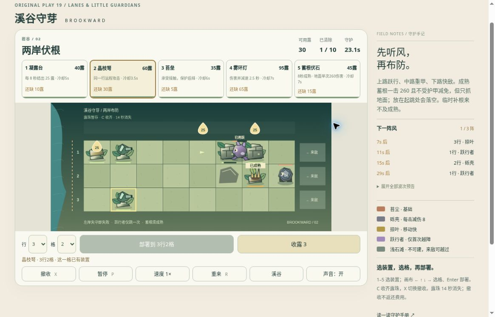

# 溪谷守芽 v2：公开浏览器有限实玩

2026-10-19，桌面Chrome，普通卡片/行列选择、部署、收露与P暂停，始终1×。运行版本：[3cb9dc4e](https://github.com/yydshly/classic-games-atlas/commit/3cb9dc4e0e2e93b5e4b818d57d1197660535107f)。参考正常预算策略，实际部署与收集由网页完成，没有修改资源、状态或存档。两场各一次，没有追加刷胜。

[试玩v2](../../versions/v2/games/brook/) · [保留v1十关](../../games/brook/) · [冻结v1](../../versions/v1/games/brook/) · [首页对比](../../#compare=brook)

## 两场实际结果

第一场“一跃之后”：31.8秒自然失败，清1/9、125露。先放凝露台、晶枝弩和前苔垒；后苔垒约16秒才到位，首跃敌已越到左侧，火力随后被摧毁。这不能解释成提前摆好双墙无效。上路伏根实际出现8秒成熟标记、随后“已成熟”，本场未记录它触发。

第二场“两岸伏根”：60.9秒自然失败，清5/10、20露、3颗未收露。7.6秒前上路两墙到位；12.1秒跃敌标可跃一次，中路根已成熟。23.1秒跃敌标已用跃，位于双墙之间并贴后墙，后墙稍后消失，支持首次越障后被后方苔垒接触阻挡。没有连续腾空画面，不能把单帧称完整跳跃动画验证。

中路地面砾壳接近成熟根，37.7秒观察时二者均消失，清数由1升至4；中路没有其它攻击装置，支持成熟根触发并清除地面甲敌的前后证据。未抓爆发瞬间、伤害数字，不把新增3个清除全部归给陷阱，也未验证精确260伤害、护甲差异或空中不触发。后续第二批跃敌的后墙补晚，再次进入火力区，最终失败。

模型正常策略67.22/70.98秒两胜只属技术证据，本轮没有真人胜利。页面为活动计时，实玩过程暂停观察，墙钟更长。

## 暂停、刷新、重试及旧入口

第一场31.0秒暂停刷新：125露、清1/9、晶枝弩冷却3.3秒、敌人位置与装置恢复并先暂停。选择格回1行3格，不属于游戏进度丢失。P暂停期间预算/冷却/时间冻结。

第二场失败后重新布防回准备态：230露、0/10、0.0秒、全卡就绪、空场；未再开始第三局。预算不足、冷却及占格会禁部署，正常收露增加实际预算。两场均可从溪谷菜单直选。

旧版页面真实打开，显示10场原创守护、首关170露/0/6，未重新玩旧十关。重试后底部仍留“有来敌越过了左侧防线”，恢复后的说明也会残留到继续/失败阶段；主状态和按钮已更新，文案残留未形成操作阻断，本轮如实记录。

## 真实运行图与可用性

[打开原尺寸截图](../../assets/screenshots/v2/brook-v2-counterplay-running.jpg)。1165×747真实网页原图，未裁切或改绘，无遮罩：第二场23.1秒、30露、清1/10，上路已用跃敌夹双墙，中路成熟根与右侧甲敌尚未接触，下路晶枝弩可见。不是陷阱触发瞬间、成功防守或终局图。

普通小幅滚动后，主图包括HUD、五卡、完整战场、行列部署/收露及暂停/速度/重来按钮；最上导航已滚出，侧栏下方说明未全显示，不是整页所有内容同屏。卡片与部署操作过程中视角有滚动变化。主体较小，已用跃敌与邻墙重叠，需要结合状态标签读图。

装置、敌人、凝露、成熟状态、晶枝弹及墙耐久实际可见。图集由Canvas路径与渐变离线绘成透明位图，不是图像生成模型产物；简化格子场景和有限姿态不能称完整成品美术。

## 参考与未验范围

原十关已有四装置、资源/冷却与分路布防；v2保留这些，新增一类首次越障的跃敌、一种需要提前成熟的地面伏根和两场编排。不是扩大植物图鉴、英雄或完整环境系统。

[EA官方初代介绍](https://www.ea.com/games/plants-vs-zombies/plants-vs-zombies)说明不同植物应对不同来敌和环境挑战。本项目借鉴装置组合与准备时机，没有使用原作角色、关卡、素材或音频，不宣称原作一致品质。

[发布时范围及技术验证](../../versions/v2/games/brook/NOTES.md)包含正常指令模型、规则边界、事件替身和离屏渲染；那些不是浏览器成绩。发布时待验状态由本页有限实玩补充，不改写为完整验收。

未验：胜利、完整后波/150秒未完成终局、逐帧完整跃起、陷阱爆发瞬间、空中/未成熟免触发、精确260伤害/护甲、雾环灯、撤收退款、2×、失焦、存储拒绝、声音听感、400窄屏/原生触屏、长期平衡及审美/整体品质。仍为有限候选，未完成品质验收。

## 2026-10-20 首场胜利补充

[独立正常UI首胜与下一场衔接记录](../brook-first-win-qa/)新增首场66.9秒/1070分/零损失，以及第二场准备态刷新与短启动；原失败记录保持，不重写为通关。本轮未改游戏源码或难度，模型参考与真实UI分开。
