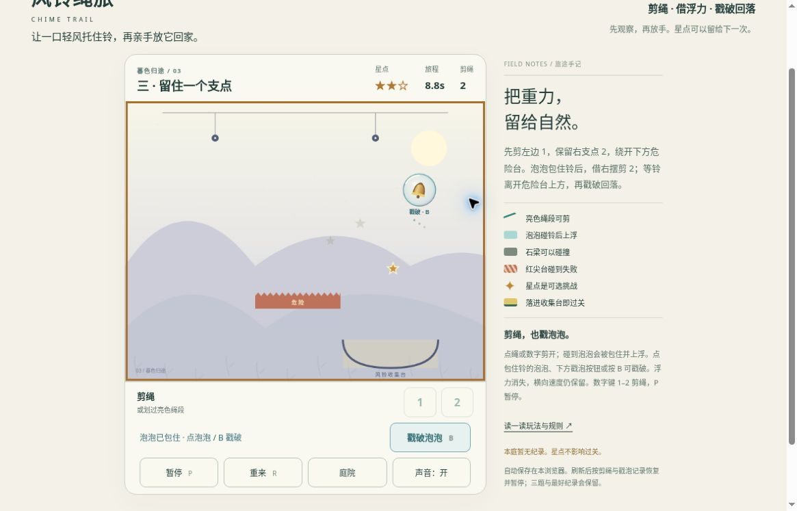

# 风铃绳旅 v2：公开浏览器有限实玩

2026-10-19，桌面Chrome，普通网页按钮与键盘。运行版本：[366ce630](https://github.com/yydshly/classic-games-atlas/commit/366ce63023e1f50ae0a38cb1d3fac94c723d4787)。三题各一局，1胜2败；没有修改资源、状态或时间，没有追加通关或刷星。

[试玩v2](../../versions/v2/games/chime/) · [保留v1十六庭院](../../games/chime/) · [冻结v1](../../versions/v1/games/chime/) · [首页对比](../../#compare=chime)

## 三题实际过程

1. 第一题：开始后正常剪第1绳。7.1秒已在泡中，暂停刷新仍7.1秒/0星/1剪/泡已包住并先暂停。继续后约12秒按B主动破泡，12.1秒2星/1剪/泡已用完，再次暂停刷新状态一致。继续自然落台，17.0秒2星成功，验证剪绳→捕泡上浮→主动戳破→落台闭环。
2. 第二题：开局按1过早剪断，未等铃右摆入泡，之后停于梁上；11.4秒0星1剪自然失败，从未捕泡。按键持有2.5秒不表示在2.5秒才剪，剪发生于按下。此局不否定模型延后剪绳的成功路线。失败后重置，没有追加第二局。
3. 第三题：开局剪左1，再剪右2，2.5秒1星2剪；2.8秒已见泡包住铃。8.8秒2星2剪，泡托铃右移越过危险台。随后约9秒按B，破泡碎滴出现，铃保留横向运动继续右移；14.6秒出界失败，未追胜。重试第三题准备0秒0星0剪，两绳与待捕泡恢复，第一题最好2星17.0仍保留。

时间均为页面活动计时，实玩过程多次暂停观察，墙钟更长。正常操作模型三题成功和正常操作时窗不计入人工成绩，也不能据此声称本轮三题真人通关或完整手感通过。

## 恢复、入口及已知提示

首题泡中7.1秒与破泡后12.1秒的两次刷新都重建了记录并先暂停；不是只依据代码推断。三题菜单从开始即可直选，星数不锁题。原版链接实际打开16庭院、首题0秒0剪准备页，未重新玩旧16关。

重试后下方失败文字“风铃离开了场景”仍会残留；首题胜利后旧恢复提示也仍在。主准备/胜败状态正确，本轮没有形成操作阻断，作为已知文案问题保留。

## 真实运行图与布局

[打开原尺寸截图](../../assets/screenshots/v2/chime-v2-third-bubble-running.jpg)。1165×747真实网页原图，未裁切或改绘、无遮罩。第三题8.8秒/2星/2剪，铃在右上泡中，已越过危险台且尚未主动戳破；非胜利、落台或破泡瞬间。该局之后14.6秒失败。

初始大标题占高，底部操作不全；正常滚动后HUD、完整约526×406场地、剪绳/戳泡/暂停/重来/庭院可同时看见。主图导航与大标题上半滚出，不能称整页原首屏所有内容同屏。普通剪绳点击、数字1/2、P与B有效，暂停时动作按钮禁用。

铃、泡、星、绳端、石梁/危险台及收集台实际渲染，全部为原创Canvas几何/渐变，没有新增图片素材。小铃细绳与淡背景的审美及原作相似品质未验。

## 参考、范围与未验

原v1已有重力、双绳、风区/梁/危险和16庭院；v2本轮补一次性可捕获/主动戳破的泡泡与三短题，保留动量和绳约束。无原作角色、布局、关卡、音画或品牌资源复制。

本轮设计参考：[ZeptoLab系列玩法说明](https://www.zeptolab.com/franchise/cut-the-rope)中的操作顺序、时机和可选星；[Arkadium机制说明](https://support.arkadium.com/en/support/solutions/articles/44002797498--cut-the-rope-how-to-play-tips-scoring)中泡泡托物上升直至戳破的规则。只借鉴通用机制，不代表整个原作机关系统或角色反馈。

[发布时范围及模型证据](../../versions/v2/games/chime/NOTES.md)的解法表已明确标“模型结束”，包含12组引擎、事件/保存测试和离屏画面；发布时待验状态由本页有限实玩补充，不改写成完整验收。

未验：第二/第三胜利、全星、实际点泡本体与划绳、失焦、45秒上限、红台碰撞、声音听感、400窄屏/原生触屏、长期手感、审美及整体品质。仍为有限候选，未完成品质验收。
