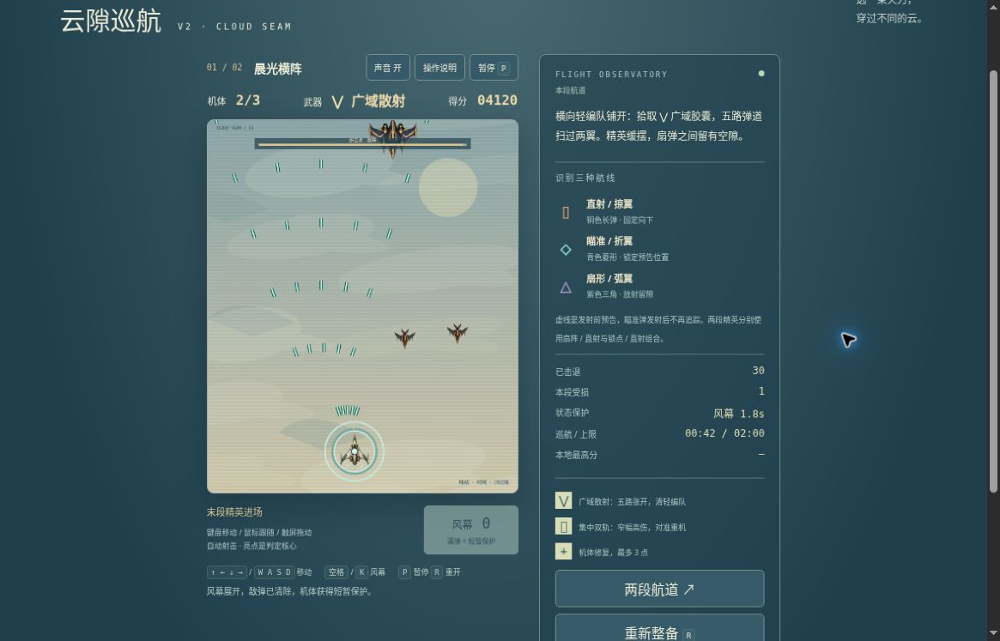

# 云隙巡航 v2：公开浏览器有限实玩

2026-10-19，桌面Chrome，普通键盘与网页按钮。运行版本：[03c62178](https://github.com/yydshly/classic-games-atlas/commit/03c621787cd06467289854f3089d40cddb9a3e28)。没有修改资源、状态或存档，模型成绩不计入实际成绩。

[试玩v2](../../versions/v2/games/cloud/) · [保留v1八段](../../games/cloud/) · [冻结v1](../../versions/v1/games/cloud/) · [首页对比](../../#compare=cloud)

## 两段各一次正常对局

- 晨光横阵：78.8秒自然获胜，5900分、击退31、机体1/3、本段受损2、风幕0。初始集中双轨，普通移动实际拾到广域，HUD与提示变为广域散射，五路向两翼展开；轻编队被击退、分数增长。大型精英、血条下降及扇形紫三角/铜色直射可见，最终胜利。
- 第一关两次风幕2→1→0，敌弹清除、环状保护、倒数与文字反馈出现。仍受到两次伤害，机体3→2→1。
- 暮色装甲线：约00:43自然失败，1580分、击退5、受损3、机体0/3、剩1风幕。看到窄双轨、装甲机、青菱形瞄准弹与预告虚线；00:18两种胶囊并列，00:41反馈“已切换集中双轨”。拾前已为集中，这证明集中胶囊拾取反馈，不能说这一刻才发生不同形态切换；第一关集中→广域才有实际形态变化。
- 第二关00:30成功用一次风幕，末尾按空格时已经失败，剩1未消耗，不能计第二次成功保护。精英进场附近即失败，未充分观察完整锁点/急移节奏或击败它，没有追加刷胜。

两关操作与路线不同，5900对1580不能推出武器强弱或关卡平衡结论。页面为活动计时，实玩过程多次暂停观察，墙钟更长。未连续记录同批另一颗胶囊消失瞬间，不把规则模型当互斥实证。

## 暂停、重试、刷新和旧入口

P暂停/继续可用；第二关暂停00:18，恢复仍00:18。失败后重新巡航恢复3命、2风幕、初始集中、0分/0击退/0受损。刷新回所选第二关准备00:00，不保留中途战场；菜单中第一关5900最高分仍在。两段可直接选择，首胜后“前往下一段”也正常。

原版链接实际打开01/08晨线航道与八段菜单入口，未重新开始旧八关。失焦、存储拒绝、修复胶囊等分支本轮未实际验证。

## 真实运行图与布局

[打开原尺寸截图](../../assets/screenshots/v2/cloud-v2-scatter-elite-running.jpg)。1165×747桌面视口，原图未裁切或改绘，无遮罩：第一段00:42、4120分、2/3命，风幕0且保护倒数中，五路散射与刚入场大型精英可见。它不是78.8秒胜利帧，也不记录第二段集中拾取的那一刻。

普通向下滚动后，HUD、完整纵向战场、暂停和风幕键同屏；页头已滚出，侧栏最下方重新整备/手册仍需再滚，不能声称完整页面所有控件同屏。机体图集在实际网页已显示；金色核心、铜直弹、青菱形、紫三角和两种火力可分辨。战场窄纵、机体较小，浅背景和细弹/扫描线令读图较细碎；第二段深色背景对金色双轨较清晰。胜败遮罩内部有滚动条，未判为硬阻断。

## 范围、参考与未验

原v1已有八段、自动射击、三级火力、三种敌弹、风幕及末段精英；v2本轮补固定强度双火力拾取选择和两种编队/精英组合。原创AI辅助机体图集已使用，背景/弹道/效果为程序绘制；没有复制原作资产，也没有完整美术或原作一致性通过声明。

[范围、来源与发布时技术证据](../../versions/v2/games/cloud/NOTES.md)。其中模型合法胜败、120秒边界、DOM事件及离屏渲染只属技术证据，发布时“尚待浏览器”的状态由本页有限实玩补充，不改写成完整验收。

本轮机制参考：[Raiden IV: OverKill官方手册第5页](https://shared.akamai.steamstatic.com/store_item_assets/steam/apps/323460/manuals/raiden4overkill_manual_digital.pdf?t=1658841837)的主武器道具改变类型并升级。此处仅借鉴战场拾取选择，不是初代完整复刻绑定；本作固定强度双选，没有原作完整主/副武器、机体阵容、长程编排与评分体系。

第二关胜利及完整精英节奏、120秒未完成终局、严格同批互斥、修复拾取、失焦、存储拒绝、声音听感、400窄屏/原生触屏、长期难度与审美/整体品质均未验。仍为有限候选，未完成品质验收。
