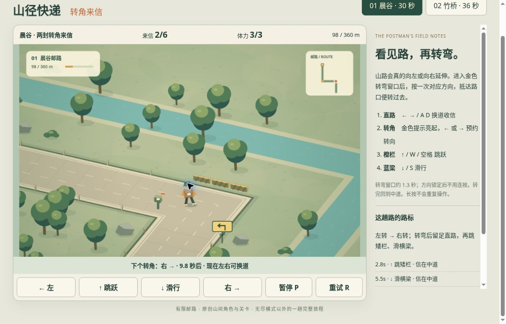

# 山径快递 v2：公开浏览器有限实玩记录

2026-10-19，桌面 Chrome，普通按钮、方向键与 P。参考路线与时机提示，多次暂停观察；两路各一局完成后停止。并非连续盲跑，状态仍为有限候选，未完成品质验收。

- [运行版本 a7e8990](https://github.com/yydshly/classic-games-atlas/commit/a7e89900c50844ced86525edd2c63e1a6c559952)
- [该版本部署记录](https://github.com/yydshly/classic-games-atlas/actions/runs/39342167626)
- [试玩转角来信](../../versions/v2/games/courier/) · [规则与参考来源](../../versions/v2/games/courier/NOTES.md)
- [原版十二路](../../games/courier/) · [冻结 v1](../../versions/v1/games/courier/) · [首页对比](../../#compare=courier)

## 两路实际送达

| 邮路 | 实际结果 | 转向与操作 |
| --- | --- | --- |
| 晨谷 | 360/360 米，8/6 封信，3/3 体力，2 次转弯、0 碰撞 | 左转、右转，使用换道避箱、跳跃与滑行 |
| 竹桥 | 432/432 米，10/7 封信，3/3 体力，3 次转弯、0 碰撞 | 右转、左转、右转，使用换道、跳跃与滑行 |

30/36 秒对应路线活动时长，不是墙钟完成速度或不中断实玩证明。两次成功不能代替无提示难度、自然失败、全玩法平衡或原作效果对照验收。

## 真转弯与保存

- 首路 80 米、2 封信、3 体力，左转窗口中按左，页面显示方向锁定。刷新后数据与锁左状态相同，并先暂停；继续后实际左转，最后总计 2 转，没有重复转弯表现。
- 98 米真实活动图显示道路拐角与场景朝向改变，人物进入左向道路，进度与下一次右转提示相符。该帧不是只有文字箭头变化，但也不是连续相机旋转录像。
- 后续首路右转、次路右／左／右有运行道路与终局次数证据。本轮没有观察到重复预约或转后重复换道；全部长按与精确窗口边界未逐项真人验证。
- P 暂停后进度保持，恢复继续前进。次路送达后“再跑本路”，起步即暂停到 2 米、0 信、3 体力，刷新保持相同并先暂停，最好 10 信／0 碰撞保留。
- 未发生错转、漏转、三次碰撞或缺信终局，本轮失败分支未验。

## 真实运行图

[查看未裁切原尺寸运行截图](../../assets/screenshots/v2/courier-v2-first-turn-running.jpg)

原图 1165×747。首路左转后 98/360 米、2/6 信、3/3 体力，下次右转 9.8 秒；无遮罩正常运行。不是跨弯瞬间、碰撞或终局，也不证明所有连续相机帧完整平滑。

## 页面与范围

- 当前正常滚动位置能完整看见主场地、信件／体力／路程 HUD 和左右／跳／滑／暂停／重试按钮。顶部图鉴导航已滚出，右侧说明为独立滚动区域，不是全页首屏同屏。
- 原创程序 Canvas 绘制的角色、道路、树木、河流、路牌、小地图可辨认，没有明显空白块；主体较小、简化图形，本轮未完成美术或动画品质验收。
- v1 原本已有十二条三道有限邮路、自动前进、换道、跳滑、收信与三碰失败。本轮新增两条真实转角路线和预约转向窗口，未把旧机制当首次实现。
- 原版入口实际打开旧 01 准备态，0/7 信、3 体力、0/280 米，十二路保留；没有重玩旧关。v2 使用独立保存键。
- 错转／漏转、碰撞扣血及三碰终局、缺信失败、全部精确窗口、失焦冻结与完整连续相机动画未验。
- 声音反馈、400 CSS 窄屏、原生触屏、总体美术／动画／手感品质未验。本地模型和离屏渲染不算浏览器实玩。

## 参考原作与差异

[Imangi 官方 Temple Run 介绍](https://imangistudios.zendesk.com/hc/en-us/articles/4995833305747-About-Temple-Run)列出转向、跳跃、滑行与避障。本作借鉴读前路、及时选择方向的操作价值，采用原创邮路、人物与送信目标。它只有两条有限路线，不具原作无尽延伸或完整长期奖励／角色系统；本轮成功也不证明拥有同等吸引力。
