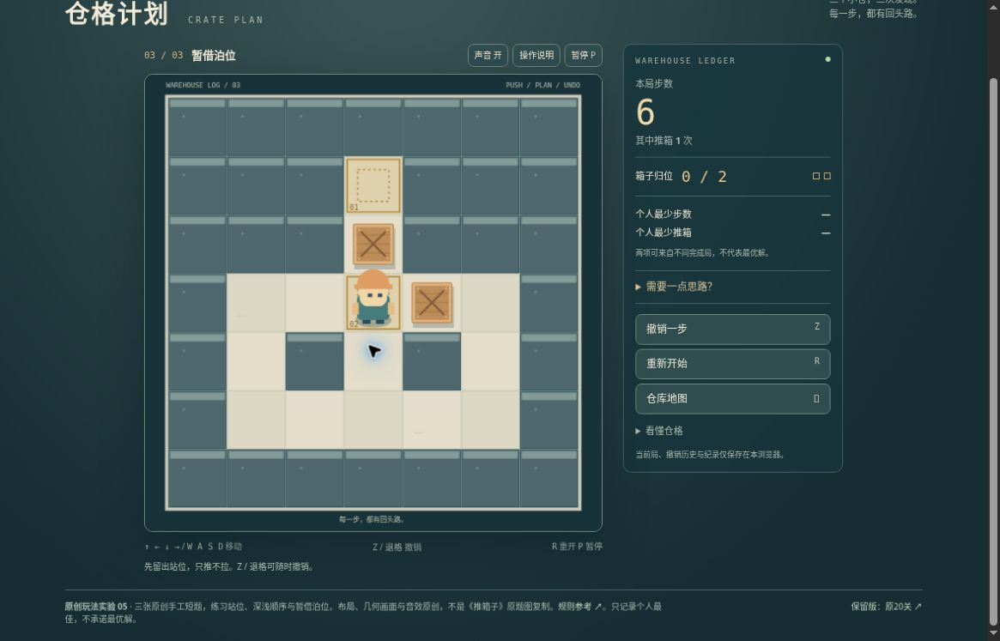

# 仓格计划 v2：公开桌面浏览器有限实玩

日期：2026-10-20，UTC 07:38–07:43。运行提交 [46bfb165](https://github.com/yydshly/classic-games-atlas/commit/46bfb165793de3b1e2e749e18c60a33f1179d9ed)，[Pages 部署记录](https://github.com/yydshly/classic-games-atlas/actions/runs/39387514390)。

[独立 v2](../../versions/v2/games/crate/) · [原版二十题](../../games/crate/) · [冻结 v1](../../versions/v1/games/crate/) · [范围与来源](../../versions/v2/games/crate/NOTES.md) · [首页对比](../../#compare=crate)

## 三题实际完成

桌面 Chrome，普通方向键、Z、P 与页面按钮。已知三题围绕站位、深浅、借位的主题，看首次操作手册与题名，未展开游戏内“需要一点思路”或读逐步作者路线。不能当作毫无线索盲解或所有玩家难度证明；没有为最少步重刷。

- 留一个站位：15 步、4 推、2/2。先向上暂移下箱，获得推上箱的站位，再绕回将下箱归位。
- 先深，后浅：19 步、6 推、2/2。先把一箱送入最深目标，再将另一箱停在浅目标；实际有额外绕行。
- 暂借泊位：15 步、3 推、2/2。将已归位箱右移，归位从 1/2 变 0/2，借目标格推动另一箱，再绕右侧归还借位箱。

三题各一次正常解到完成，实际步数不同于模型参考 13/15/15。第一题另做胜后撤销并重走最后一步，不算第二条策略通关。没有自然卡死，未主动制造错误角落，也没有验证死锁提示；本作不设失败弹窗。

## 恢复、撤销与重玩

第一题 5 步、2 推、1/2 暂停刷新后，先显示继续当前局，棋盘与计数相同。继续后一次紧接的 Z 未改变画面，再正常按 Z 回到 4 步、1 推、0/2，上箱退出目标。可见撤销历史跨刷新保留，但未验证全部深度或上限。

首题胜后撤销到 14 步、3 推、1/2，最好仍 15/4；再向右推一次完成。第三题终局重玩直接进入 0 步、0 推、1/2 的活动初盘；未移动就刷新，回第三题准备遮罩，暂停按钮禁用，0/0/1 与最好 15/3 留。这是零步初盘刷新语义，不称活动局精确暂停恢复。

第一批快速输入中一次 Up 未生效，观察后单步输入正常；没有据此判定键盘故障。三题通过“继续下一仓”进入，未另测地图直选切换或输入清空边界。

旧入口实际打开原版 01/20“一箱启程”0 步、0 推、0/1 准备态，未重玩原二十题。

## 真实运行图

[查看未经裁切的原尺寸截图](../../assets/screenshots/v2/crate-v2-borrowed-berth-running.jpg)

1165×747，第三题 6 步、1 推、0/2。原来已归位的箱子在中央目标右邻格，角色站腾出的目标，上方箱尚未归位。无遮罩的稳定活动棋盘，非推动动画或终局。归位暂降为 0/2 是策略步骤，不是丢档。

## 布局与未验

程序几何棋盘、人物、箱体与目标实际可辨。正常滚动后棋盘、主要控件、记录栏同屏；顶部导航滚出，大标题部分切出，底部也可能超出，不能称整页始终同屏。少数箭头/图标显示方框，文字功能名仍可识别，没有阻断本轮操作。

只推不拉、无限撤销、胜后撤销、日志恢复、静态角提示是旧机制。本轮新增重点为三题策略布局，有限完成不等于基础玩法全新或品质验收。

未验：自然卡死和复杂死锁提示、全部撤销历史/20,000 步上限、切图、长按、手机/原生触屏、音频听感、完整动画与审美品质。声音开关显示开不代表已经听验。
