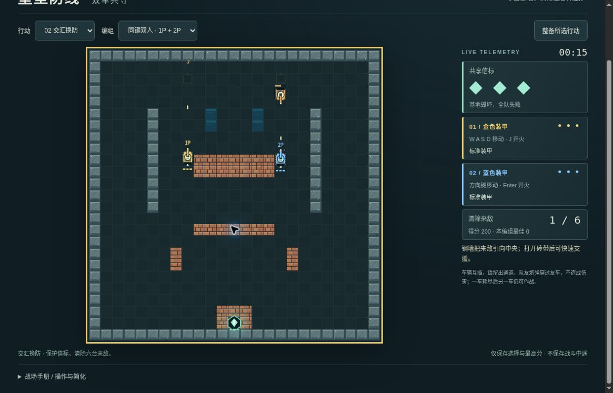

# 堡垒双车 v2：有限公开桌面浏览器实玩

时间：2026-10-20 08:29–08:34 UTC。运行提交 [2d67e368](https://github.com/yydshly/classic-games-atlas/commit/2d67e36889e3dd051dc2ffe316d8ea2838cab42a)，[Pages 部署记录](https://github.com/yydshly/classic-games-atlas/actions/runs/39393188142)。

[独立 v2](../../versions/v2/games/fortress/) · [原十关](../../games/fortress/) · [冻结 v1](../../versions/v1/games/fortress/) · [范围与来源](../../versions/v2/games/fortress/NOTES.md) · [首页对比](../../#compare=fortress)

桌面 Chrome，正常键盘、选择框与按钮；读页面手册，未预先读取通关路线。一个执行者分别操纵两车，多次暂停观察，不是两位玩家协作测试或连续速度挑战。页面时间不等于墙钟时间。

## 首图单车：正常基地败

沿左路上行、返回下部、横移护基地，普通 WASD+J 移动射击。00:19 清 1/6、150 分、基地三格；00:31 基地两格；00:34 清 2/6、300 分、基地回三格，符合途中维修的可见结果，但未单独抓到拾物瞬间。之后基地 2→1→0，00:48 显示基地耐久耗尽，清 2/6、300 分，玩家仍三次出击。

这是正常尝试自然失败，没有故意站定等死。失败后重新整备恢复 READY：00:00、0/6、0 分、基地三格、1P 三次；本编组最佳仍 0，未把失败 300 分当作已保存最好。

## 次图双车：有限成功

选择交汇换防与同键双车，按钮开始，分别用 W+J、方向上+Enter 移动开火。金色 1P、蓝色 2P 分别移位，两路炮弹、1P 护盾与 2P 速射的不同状态可见。

- 00:03 清 1/6、200 分，各三格；1P 护盾 5s、2P 速射 9s。
- 00:15 清 1/6、200 分，两车标准装甲，右路敌人接近蓝车，双路弹线可见。
- 00:23 清 2/6、380 分；00:32 清 3/6、480 分；00:47 清 4/6、780 分；01:03 清 5/6、960 分。
- 最终清六敌胜利：结算显示 69 秒、2110 分，HUD 为 01:08。按原样记录显示取整差异。基地三格、两车各三次出击，最佳 2110。

两场地图与模式同时改变，不能做单双模式难度的受控比较。两车移动射击可用不等于两名玩家合作体验通过。未专门触发实体互挡、友弹穿越、一车耗尽另一车继续或 Enter 开始后释放的防误射边界。

## 暂停、刷新与重试

多次 P 暂停观察期间，计时与状态保持。第二胜后再次出击直接运行新局，仅做短刷新测试，不算另一完整对局：W+J 后 00:01、50 分、0/6、1P 护盾 8s，P 暂停。暂停时 D+J 一秒，仍显示相同计时、分数、清敌与护盾时间。没有逐像素比对所有弹丸。

P 恢复后刷新，回第二图双车 READY：00:00、0/6、0 分、基地三格、两车各三次、标准装甲、最佳 2110。仅选择和最好分保留，不是战斗中途快照。

原版入口实际打开 01/10 晨雾哨站准备态：基地 3、三辆、0/6、00:00，没有启动原版。

## 真实运行图

[未经裁切的原尺寸截图](../../assets/screenshots/v2/fortress-v2-dual-fire-running.jpg)

1165×747，第二图双车 00:15、200 分、清 1/6，基地和两车均三。金蓝车、右路敌人及两路弹线可见。无遮罩活动帧，非终局，也不证明友弹穿车或车体互挡；一个执行者分键操作。页头与顶部暂停按钮已滚出。

## 布局与未验

初始视口标题、选择框、HUD 可见，战场底部在视口外；正常向下滚动后才看完整地图、车状态、基地、得分与整备控件。此时顶导航和暂停按钮滚出，实际用 P 暂停。不能称全部界面同屏。

金/蓝/橙车、砖钢墙、水域和弹线可分辨，未见资源缺失或键盘硬阻塞。程序画面简化，素材动效和审美没有验收。

未验：两名玩家同时操作/键盘鬼键、实体互挡、友弹穿越、单车耗尽续战、特殊 Enter 防误射、全部道具/地形碰撞、全部模式最好分隔离、手机/原生触屏、声音听感和审美品质。
