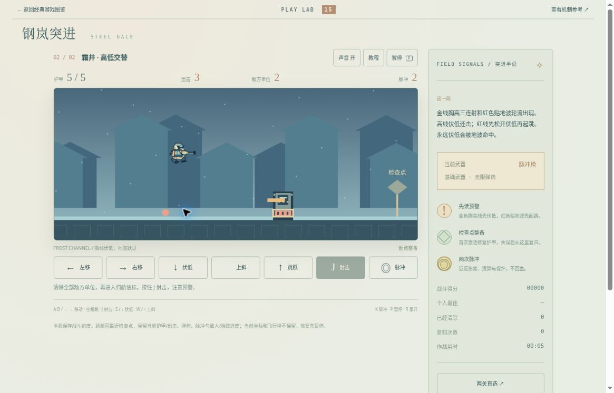

# 钢岚突进 v2：公开桌面浏览器有限实玩

时间：2026-10-20 08:05–08:09 UTC。运行提交 [b538219d](https://github.com/yydshly/classic-games-atlas/commit/b538219df992d334c16ad411163fb9f82431e88f)，[Pages 部署记录](https://github.com/yydshly/classic-games-atlas/actions/runs/39390565275)。

[独立 v2](../../versions/v2/games/gale/) · [原八关](../../games/gale/) · [冻结 v1](../../versions/v1/games/gale/) · [范围与来源](../../versions/v2/games/gale/NOTES.md) · [首页对比](../../#compare=gale)

## 两场实际完成

桌面 Chrome 普通按键和页面按钮，读取首次作战手册与可见预警，未预先读取通关路线。多次 P 暂停观察后分段按键，属于辅助观察的有限实玩。页面作战时间不等于墙钟或速度成绩。

- 铜港：清两装置并走到右出口，200 分，页面 00:16，5/5 甲、3 出击、余 1 脉冲、复归 0。先前进再 S+J，目标 2→0，期间未掉甲。金色胸高预警可见，低位射击清除了装置。松键后截图人物已起身，没有捕到持续按住伏姿的连续帧，也没有逐发胸高弹擦身证明。
- 霜井：清两装置并走出口，200 分，页面 00:30，终局 5/5 甲、3 出击、余 1 脉冲、复归 0。约 00:04 红色地波预警出现；第一次跳后地波尚在前方，又正常跳跃。主图 00:05 人物空中、地波位于其下方偏左、护甲仍 5。随后有意持续 S，5→4 甲；S+J 后至 3 甲、清 1。前进到检查点修回 5，再跳进、用 K 和 S+J 清剩余装置，走到出口。

第二场不是无伤通关。持续伏低受伤是有意延长动作后的有限观察，没有出击耗尽或自然失败。单张跳跃与地波同屏及护甲读数不是完整逐帧碰撞范围、受伤帧或无敌时间的验证。本轮没有为制造失败追加对局。

## 检查点恢复、暂停和重访

首场清 2、200 分，过检查点 1 后用 K 将脉冲 2→1，再 P 暂停刷新。恢复先暂停，5 甲、3 出击、待清 0、脉冲 1、200 分、清 2、复归 0、00:13 均保留。存档按检查点语义恢复，不声称当前坐标、飞行弹逐帧保存；未测未命中飞弹或部分敌甲的完整保存。

首胜后经“选择航段”进入第二准备态，两项可选。准备页短暂保留前场归航提示，开始后更新，是残留文案。

第二胜后“重访这一段”立即运行新局，5 甲、3 出击、2 敌、2 脉冲、0 分、00:00，最好 200 保留。随后开旧版标签期间，本局继续约 9 活动秒并受击。回到本页刷新后，从第二场起点先暂停：3 甲、3 出击、待清 2、脉冲 2、0 分、00:09、最好 200。没有再操作战斗或完成新尝试。不能声称切换标签可靠触发自动暂停；也不能把先前活动期间扣甲归于刷新。

原八关实际打开 01/08“锈港初行”准备态：5 甲、3 出击、4 敌、2 脉冲、0 分、00:00，没有重玩八关。

## 真实运行图

[查看未经裁切的原尺寸截图](../../assets/screenshots/v2/gale-v2-groundwave-running.jpg)

1165×747，第二场 00:05、0 分、5/5 甲、3 出击、2 敌、2 脉冲。人物空中，红地波位于下方偏左，右侧第一装置仍在。无遮罩活动帧，按键释放后取图；不是伏低姿态、命中、清敌或终局。

## 布局、来源与未验

宽屏首屏可见导航、场次/HUD、完整战场和主战斗按钮；右栏底部直选/重新整备/手册及旧入口仍需正常滚动。遮罩自身有滚动条，不能说全部内容整页同屏。人物、装置、预警和弹体可见，没有硬加载阻塞。

姿态由原创程序矢量绘制。战场较小、表现简化，部分符号呈方框、提示有残留。两场完成不能替代原作一致性或审美验收；原作基础伏低操作参考是第三方手册转录，详见范围与来源。

未验：出击耗尽失败和失败后重试、空中下键身体边界、长按、完整高低弹碰撞/存档相位、所有武器与原八关、手机/原生触屏、声音听感和审美品质。声音开关显示开不代表听验。

## 独立修前复核：08:47–08:48 UTC

原两场通关后另做一次真实前台标签切换。正常继续第二场起点 00:09、3 甲、3 出击，点击浏览器标签栏切到另一图片标签，确认图片在前台并等待 10 秒，再点击回游戏。

返回仍为活动画面，没有暂停遮罩，显示“暂停 P”、00:12、3 甲、3 出击、敌 2、脉冲 2、0 分。9→12 包含切换前后观察间隔，不能把全部时间差精确归于后台。未采集事件日志或页面焦点值，无法唯一定位哪个事件未生效。之后活动继续并自然受伤复归，P 停在 00:23、5 甲、2 出击、复归 1、敌 2、脉冲 2、0 分、最好 200。这次未通关，也不覆盖早前两胜。

## 独立修后复核：防御暂停 r1

[修补提交 c085799](https://github.com/yydshly/classic-games-atlas/commit/c085799fac1bc2d0ece3adab0e1c66332123157b) · [部署记录](https://github.com/yydshly/classic-games-atlas/actions/runs/39396756506)

仅游戏控制器和加载版本串改变。每次更新前发现页面隐藏、失焦或原始渲染帧间隔超过 1000ms 时保守暂停，清除旧按键，需明确继续。已有生命周期事件处理保留；不改引擎、数值、美术或 v1。实际主线程卡顿超过一秒也会要求继续，这是取舍，不是根因诊断。相关规则测试不替代浏览器实测。

修后确认加载 game.mjs?lifecycle-pause-r1-20261020 后，正常继续 00:23、5 甲、2 出击。真实点击另一前台标签，等 10 秒，再回游戏：此次先显示暂停，00:24、5 甲、2 出击、敌 2、脉冲 2、0 分、复归 1、最好 200。23→24 含切换前后短暂操作间隔，不称逐帧零推进。

正常点击继续并按 S 约 2.2 秒，游戏活动到 00:26，没有立即反复自动暂停；最后 P 停，资源仍如上。遮罩沿用“整备已接续”文字，不能据此推断切换读取了检查点。本次只有一次切换与继续按钮检查，没有重打两场、额外制造主线程卡顿或证明所有浏览器均通过。

本页前面的两胜与主战斗截图均属于 b538219 修前版本。保留原异常与修后结果分列；c085799 的有限返回暂停检查不能被扩大成重新通关、全生命周期或品质验收。本项修补到此收口。
