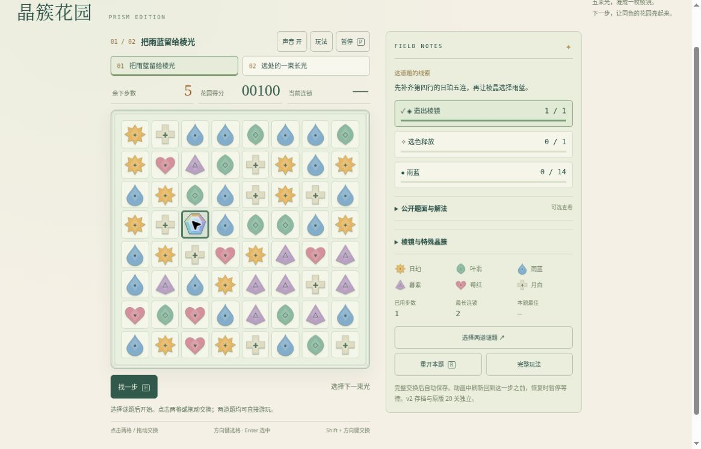

# 晶簇花园 v2：公开浏览器有限实玩

2026-10-19，云端桌面Chrome，正常网页点击。运行版本：[8f3bb1ae](https://github.com/yydshly/classic-games-atlas/commit/8f3bb1aeaa3050b220639fef4836e67555ceef98)。两题各一次，使用页面公开参考解法，每步等待棋盘落稳；不是独立盲解或完整品质验收。

[试玩v2](../../versions/v2/games/garden/) · [保留v1二十关](../../games/garden/) · [冻结v1](../../versions/v1/games/garden/) · [首页对比](../../#compare=garden)

## 两条普通点击路线

行列从1开始。

1. 第一题，种子109，6步预算。先尝试第1行第1列与第2列相邻交换，无匹配后回弹，提示不消耗步数，仍6步0分。按公开路线，将第3行第3列向下交换至第4行第3列形成横五连；落稳剩5步100分、造棱1、释放0、雨蓝0/14、最长2连。第4行第3列为棱晶，右邻为雨蓝。刷新后可见盘面、5步100分和目标一致并先暂停。继续后选棱，再点右邻雨蓝，第二次合法交换扣至4步；终局460分、用了2步、最长2连、造棱1/释放1/雨蓝14/14，成功。
2. 第二题，种子580，8步预算。正常直选并展开页面参考说明，第3行第3列向右交换到第3行第4列形成纵五连；落稳剩7步190分、最长3连，棱晶落到第5行第4列，上邻第4行第4列为叶翡。第1行第8列原有叶翡清列晶，土层目标仍0/4。选择棱晶再点上邻叶翡，扣至6步，提示同色晶簇亮起、19枚晶簇消除及特殊已触发。终局380分、用了2步、最长3连、造棱1/释放1/叶翡10/10/土4/4，成功。

第二题远列土清除有前后目标、棋盘及触发提示支持；没有保存完整连续列光动画，不把单帧当连续动画证明。

页面收色目标显示封顶于14和10；模型报告原始累计收集20和12是另一统计口径。实玩页面没有显示20/14或12/10，不能把两种数字混写为同一观测。

## 恢复、重试与旧版入口

第一题造棱后稳定盘刷新，棱位置、5步100分、造棱1、最长2连及可见目标保持并先暂停。没有逐字段比对隐藏补充序列，也未实测动画中刷新回滚。

第二终局点重试，立即回同题活动初盘：8步0分、0用步/0目标、原土层与清列晶，最好380保留；随后暂停停止，没有追加刷题。

两题从开始可直选，公开解法实际展开阅读；没有使用“找一步”按钮。无效交换不扣步、合法交换扣一步、棱生成保留、邻色释放和终局均正常点击完成，本轮没有遇到交互冻结。

旧版链接实际进入第01/20关、18步0分准备页，没有重玩旧20关。

## 真实运行图与布局

[打开原尺寸截图](../../assets/screenshots/v2/garden-v2-prism-selected-running.jpg)。1165×747真实网页原图，未裁切或改绘、无遮罩。首题活动稳定盘，剩5步100分、造棱1/1、释放0/1、雨蓝0/14；第4行第3列彩虹棱晶选中，右邻雨蓝尚未点击。它是造棱后、释放前的状态，不是生成/消除瞬间或终局。

正常点击滚动后，完整8×8棋盘、HUD/题选择/暂停、右侧目标和重开控件可见；页顶导航与标题上部滚出。公开解法展开时，较长参考盘和底部控件仍需继续滚动，不称全页原首屏同屏。主图已收起解法。

程序SVG晶体具有颜色、形状与符号区分，彩虹棱可识别；浅背景、淡边框和简化质感仍有限。游戏运行没有新增位图，玩法闭环不能代表原作美术、手感或审美通过。

## 参考、范围和未验

原v1已有20关三消、连锁、四连线晶、五连/TL花蕊与土层目标。v2把直线五连改成无色棱晶，再选邻色释放，T/L花蕊和四连线晶保留；两题固定公开棋盘采用有限步数和原创目标，第二题为转置/换色后重选补落种子的同一规则练习。

[PopCap/EA的Bejeweled 3作品介绍](https://store.steampowered.com/app/78000/)描述经典、任务、限时、放松等八种模式，本候选没有实现完整模式体系。[本轮范围与资料线索](../../versions/v2/games/garden/NOTES.md)保留官方攻略链接及作者对搜索摘要的核读说明，不把摘要当成阅读全文或完整规则一致性证明。

发布时13组规则、独立800局/5504合法交换、195离屏帧和10组DOM替身检查与本页实玩分开。NOTES的浏览器待验是发布时状态，由本页两条有限实际路径补充。

未验：自然耗尽步数失败、独立盲解、错误选色策略、最后一步目标优先、动画中刷新、双棱与全部特殊互换/最多色平手、鼠标拖交换/键盘交换、声音听感、400窄屏/原生触屏、长期策略、审美及整体品质。仍为有限候选，未完成品质验收。

## 2026-10-20 自然耗步失败补充

[独立正常UI失败→重试记录](../garden-loss-qa/)补六次合法交换后0步/180分自然失败、明确说明、重试6步/0分/固定初盘与已有460分纪录保留。本轮只补证据，不改运行代码，不追认其它未验边界。
