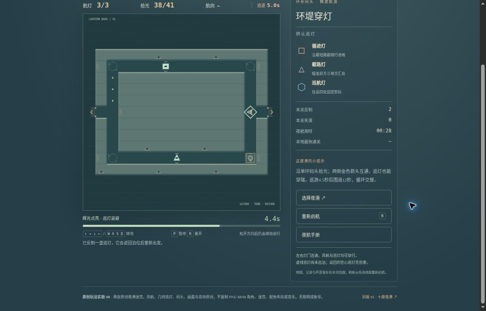

# 夜航拾光 v2：公开浏览器有限实玩记录

2026-10-19，桌面 Chrome，普通方向键、P 与页面按钮，按可见地图探索。两图各一局，随后一次短重试检查；过程中多次暂停观察，页面活动秒数不等于墙钟时间。状态仍为有限候选，未完成品质验收。

- [运行版本 2215f86](https://github.com/yydshly/classic-games-atlas/commit/2215f86b583c2a33cfc5c4322225625deae1d1be)
- [该版本部署记录](https://github.com/yydshly/classic-games-atlas/actions/runs/39340082667)
- [试玩双港短航](../../versions/v2/games/lantern/) · [范围与参考来源](../../versions/v2/games/lantern/NOTES.md)
- [原版十港](../../games/lantern/) · [冻结 v1](../../versions/v1/games/lantern/) · [首页对比](../../#compare=lantern)

## 实际结果

| 场次 | 结果 | 本轮范围 |
| --- | --- | --- |
| 环堤穿灯 | 45.8 活动秒，41/41 收齐，余 1/3 命，反制 2、失误 2，自然胜利 | 沿外环探索、穿隧，受伤复位后收齐最后光点 |
| 双湾交汇 | 约 37 活动秒，38/46，三命耗尽，反制 0、失误 3，自然失败 | 经外环与中央通路探索，没有追加重跑争取胜利 |

有限一胜一败不等于两图都通关或完整难度平衡。两图可直接选择；本轮通过首胜后的“前往下一港”进入第二图，菜单两项可见，但未从菜单分别重新开两图。

## 隧道、状态与反制

- 首图左侧入隧后，玩家实际出现在右侧灯门内，收点由 30 到 38。主图是穿隧后的运行状态。未连续记录跨边全过程，不能证明全部中间帧都没有横扫；敌人穿隧、隧中接触与回巢完整路线未逐项实玩验证。
- 两图都见巡航 4.5 秒／追逐 12 秒循环。首图先后显示初始巡航 4.3、00:09 追逐 6.9、00:18 巡航 2.3、00:28 追逐 5.0。时长为本作原创安排，不是原作精确 AI 还原。
- 拾取辉光后，倒计时、外框与退避状态可见，首图反制计数升到 2，并提示巡灯返回泊位；没有连续记录逐只回巢全过程。
- 首图 00:28 辉光剩 4.4，00:33 已熄灭，继续后约 00:37 受伤；第二图也观察到辉光消失后恢复危险。该证据不涵盖精确到期同帧碰撞。
- 松开方向键仍前进、提前输入的待转提示可见。本轮未完整评估持续转向手感或各敌人目标策略。

## 暂停、重试与刷新

- 首图与第二图均实际暂停、继续，收点与辉光随后继续运行。
- 第二局失败后一次短重试恢复 3 命、0 失误；右行约 0.8 活动秒后暂停为 3/46 点、辉光 6.3、巡航 3.7。这个短检查不是第三局完整挑战。
- 此时刷新回所选第二图准备态：0/46、3 命、辉光未亮、巡航 4.5、00:00。没有恢复中途 3 点或辉光，符合页面的重新启航规则。
- 首图最好 45.8 秒保留，第二图没有最好纪录。v2 使用独立存档键，原十港入口保留；本轮实际打开原版 01/10 准备页，3 命、0/78，未启航旧局。

## 真实运行图

[查看未裁切原尺寸运行截图](../../assets/screenshots/v2/lantern-v2-tunnel-running.jpg)

原图 1165×747。首图 00:28，38/41、3 命、反制 2、失误 0、追逐剩 5.0、辉光剩 4.4；玩家在右侧灯门内。它是穿隧后运行图，不能当成跨边瞬间、连续动画证明或胜利帧。页头与上方暂停按钮已正常滚出画面。

## 可见限制与未验项目

- 程序 Canvas 画面：几何风帆、巡灯、码头、隧道箭头均能显示。本轮未新增游戏运行位图或生成图素材，也没有审美通过结论。
- 滚后画布约 474×474 完整，道路主体只占其中一部分，偏小。主图暂停按钮已滚出；第二图另一个滚动位置能同时看到 HUD、暂停、场地、辉光与重试，不等于全页首屏同屏。
- 辉光熄灭后，底部仍可能残留“辉光点亮”提示，状态条已显示未点亮。此文字不一致尚未修正。
- 第二图胜利、敌方穿隧与隧中碰撞、精确巡追边界、辉光到期与末点碰撞优先、全部回巢动画与策略差异未验证。
- 声音开关开启但未做听音验证；400 CSS 窄屏、原生触屏、审美和完整品质未验。本地规则、模拟 DOM 与离屏渲染记录不算真实浏览器实玩。

## 原作参考边界

本轮参考 [Nintendo 的 NES Classic Edition《PAC-MAN》电子手册](https://www.nintendo.co.jp/clv/manuals/en/pdf/CLV-P-NABME_en.pdf) 所述收点、生命、横向隧道和临时反制思路。历史目录仍以初代街机为主要参考口径；这份手册不用于证明本作精确复制街机敌人 AI 或阶段时长。地图、角色、程序画面与音效均为本作原创，没有原作素材授权声明。
