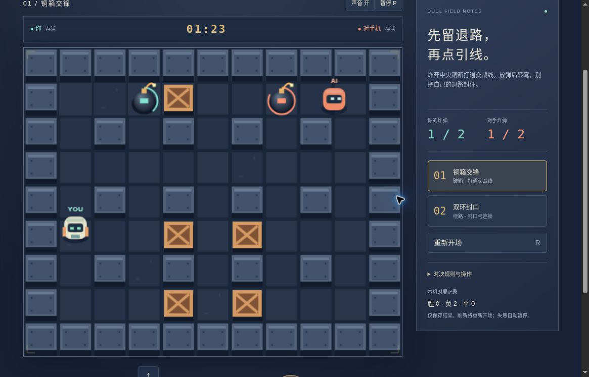

# 爆破迷宫 v2：公开浏览器有限实玩

2026-10-19，桌面Chrome，普通方向键/J/P及网页按钮。运行版本：[15a96813](https://github.com/yydshly/classic-games-atlas/commit/15a968133edaeee122af73a5c4f74e257318ff4f)。未修改资源、状态或存档，也未用模型成绩补充实际成绩。

[试玩v2](../../versions/v2/games/maze/) · [保留v1十关](../../games/maze/) · [冻结v1](../../versions/v1/games/maze/) · [首页对比](../../#compare=maze)

## 实际三次有限对局

1. 铜箱交锋：2.9秒自爆失败，破箱1、连锁0。放弹后未及时绕角，自己的爆风击破玩家；AI已放弹并撤往上方。
2. 双环封口：2.7秒自爆失败，破箱1、连锁0。短促方向输入未形成预期拐角逃离；对手在另一侧放弹并撤退。两局太短，不是充分对抗体验证明。
3. 仅补首图一次：先观察AI破箱推进，再由玩家左上布一弹，持续左/下输入绕角到左下，成功逃离自己的炸弹。随后尝试中线，后续左侧爆风击败玩家。结算14.2秒、破箱5、连锁0，最终胜0/负3/平0。玩家唯一炸弹已结束，因此后来的左侧火线可归于AI，但没有连续记录那次AI近身布弹全过程。

页面秒数不是墙钟时长，期间多次暂停观察。没有追加刷胜。玩家炸弹逼AI改路、主动反制、复杂封口、连锁、胜利、平局及90秒期限终局均未实际验证；不能用48场模型或独立规则检查宣称真人平衡、成熟竞技AI。

## 暂停、重试与刷新

P暂停/继续有效，暂停期间计时与炸弹数保持。重试恢复双方存活、1:30、玩家0弹，历史负数保留。两图直接选择可用。第二图中途刷新回首图准备态而非续战，负2保留；最终刷新仍回首图准备且负3保留。

失焦尝试未可靠触发，因此自动失焦暂停未验；不把页面说明当实际结果。存储拒绝分支也未实玩。

## 真实运行图与布局

[打开原尺寸截图](../../assets/screenshots/v2/maze-v2-map1-retreat-running.jpg)。1165×747桌面视口，未经裁切或改绘；首图补局剩1:23，青橙双方各1弹，青玩家已退左下、AI在右上，已打开中线可见，画面战绩仍为胜0/负2/平0。这不是连锁、胜利或终局帧，也不证明玩家已与AI近身反制。

该位置HUD和完整棋盘可见，页头滚出，底部方向和放弹控件仍在下方；暂停贴上沿。末局测得棋盘约757×619、底边约715；放弹按钮下沿约830，暂停部分在上方。不能称关键操作全同屏。声音按钮显示开但未实际听音；400窄屏/原生触屏及审美未验。

青玩家/橙AI、YOU/AI标签、铜箱、固定墙、阵营引信圈与十字火线可见。仍是简化Canvas机械和几何表达，没有美术质变声明。短促输入本轮未及时绕角，持续约700毫秒方向输入可明显移动并撤离，未定位为键盘故障，也不能据三次失败作总体难度结论。

## 参考与技术证据

v1已有十图清关、炸弹/连锁/自伤和移动敌人；v2新增两短图中会布弹、查退路并破箱接近的AI，无强化道具、联网、踢弹或装备。两枚容量、2.4秒引信、三格火线、90秒上限是本作简化规则。

[发布时NOTES](../../versions/v2/games/maze/NOTES.md)及目录内14组引擎、1组静态布局和48场策略模拟为技术证据；离屏画面不是浏览器截图。“尚待浏览器”是发布时状态，有限实玩结果以本页为准。

本轮机制参考：[KONAMI Standard手册](https://www.konami.com/games/bomberman/online/manual/en/ps/page04.html)的竞争生存方向与[Grand Prix手册](https://www.konami.com/games/bomberman/online/manual/en/ps/page03.html)的对抗配置。本作没有采用其完整多人、局数、复仇车或压力砖系统，也未复制原作资产；不改写历史系列绑定为某个完整模式复刻。整体品质、原作一致性及充分策略体验均未完成验收。

## 2026-10-20 首胜与期限终局补充

[独立普通UI证据](../maze-first-win-qa/)新增两次有界尝试：90秒自然平局（首胜验收失败，保留原报告），以及16.85秒自然胜利/玩家11弹/8箱/2连锁。胜场刷新和干净新局通过。只读状态辅助策略，不是人工手感；终点火线归属不支持玩家直接炸杀结论。原三败仍保留，未改游戏或难度。
