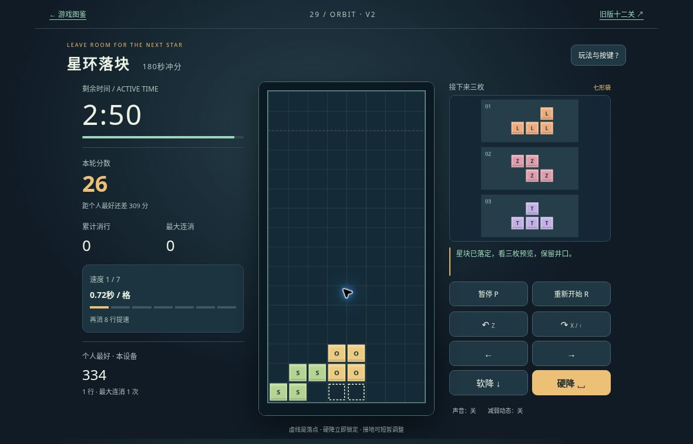

# 星环落块 v2：公开浏览器有限实玩

2026-10-19，桌面Chrome，普通键盘及网页按钮。运行提交：[8abc14f4](https://github.com/yydshly/classic-games-atlas/commit/8abc14f4587c5021cf9474d1a46cc659f87b9ed3)。通过可见棋盘与三枚预览操作，没有使用自动求解或改写存档。

[试玩v2](../../versions/v2/games/orbit/) · [保留v1十二关](../../games/orbit/) · [冻结v1](../../versions/v1/games/orbit/) · [首页对比](../../#compare=orbit)

## 实际输入与结果

- 左右按住移动、X顺转/Z逆转、Space硬降、P暂停/继续实际有效。思考时有自然落定，也使用了暂停；不是完美路线。
- 首轮旋转T形填缺口实际消1行。剩2:24时284分、累计1、最大连消1、速度1/7，还需7行提速。
- 同状态暂停后正常刷新，先暂停，仍2:24/284分/1行，预览方舟/镜角/斜阶一致。继续前计时不走；继续后目视活动块、已落棋盘和落点与刷新前一致。
- 随后自然井口占满，提前结束：334分、1行、最大连消1、剩2:21。约39秒活动时间内多次暂停思考，实际墙钟更长。没有完成180秒。
- 点击“再来180秒”，新轮3:00/0分/0行/速度1，最好334分/1行保留。随后正常左移、硬降一枚，另取下面的新轮运行图；截图后暂停，没有追新局结算。

## 当前真实运行图

[打开原尺寸截图](../../assets/screenshots/v2/orbit-v2-new-round-running.jpg)。原图1180×757，未经裁切或改绘。26分、0行、剩2:50、最好334；S已落左侧，O正在下落，预览L/Z/T。它是新轮无遮罩运行，不是首轮消1行状态或消行瞬间。该桌面视口的HUD、完整棋盘、三枚预览和控件同屏可见，不代表手机通过。

## 已知文字问题与未验范围

- 普通暂停也显示“已恢复棋盘、队列…”通用提示，不能据此认定每次暂停都发生恢复。
- 最好成绩334同分时写还差1，重开写还差335，语义像超过纪录而非追平，可能使人误解。本轮记录，没有扩展修复。
- 未实玩8行提速、7档上限、180秒自然终局、更多七袋/踢墙组合、软降长按、旧十二关、声音听感、400窄屏/原生触屏、长期难度及审美/整体品质。
- 消1行状态留存图含暂停遮罩，不用作主要运行展示；顶出结算也不作为无遮挡棋盘展示。此处只发布一张已核实的新轮真实运行图。

## 范围与证据区分

v1已有落块、旋转、清行与预览；v2取消关卡星尘目标和落块额度，改为空8×16棋盘连续冲分，最多180秒。仍是自定义旋转、踢墙、分数和固定种子，无hold、T-spin/B2B、对战或标准规则认证；不是无尽或新增十二关。程序绘制抽象方块，没有本轮美术质变声明。

[发布时NOTES](../../versions/v2/games/orbit/NOTES.md)中的13组引擎、16组控制存储、DOM替身及离屏输出属于技术证据。其中合法180秒模型177行/29134分、1100块压力日志不是人工成绩；“待真实浏览器验证”为当时状态，有限线上结果以本记录为准。

[Tetris官方玩法介绍](https://play.tetris.com/about)用于说明旋转、移动、填行腾空间和避免堆满的机制参考。本项目未锁定某个商业版本进行逐项复刻，原作名称及权利属于各权利人；有限实玩不代表原作完整质量或用户品质认可。
