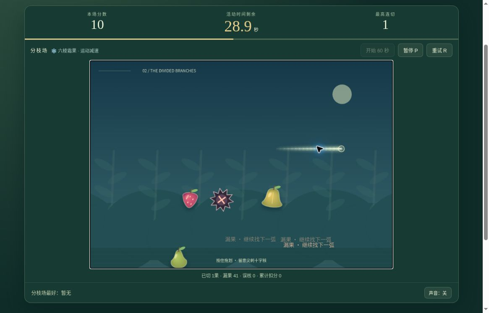

# 节拍果园 v2：公开浏览器有限实玩

2026-10-19，云端桌面Chrome，正常网页鼠标拖划及键盘操作。运行版本：[2bebadd6](https://github.com/yydshly/classic-games-atlas/commit/2bebadd6e41f67b0e0f0ddf90e6927f2d0a5ea95)。两场各一局完整60活动秒，没有额外追分。

[试玩v2](../../versions/v2/games/orchard/) · [保留v1十二园](../../games/orchard/) · [冻结v1](../../versions/v1/games/orchard/) · [首页对比](../../#compare=orchard)

## 两场实际结果

- 聚果场：98分、已切7果、最高3连切、霜果2枚、漏果74、误核0、累计扣分0。
- 分枝场：10分、已切1果、最高1连切、霜果0、漏果80、误核0、累计扣分0。

两场都完整运行60活动秒，页面显示完成；没有胜利分数门槛，不能写成两关胜利。大量漏果没有提前结束。暂停不计入活动时间，实际观察过程更长。

## 划切、布局与霜果

早期鼠标拖划没有命中，观察到操作执行与屏幕更新存在延迟，水果已换位置；这不足以判定产品碰撞或手势阈值有问题。后续使用混合拖划与页面支持的空格加左右键刀光，取得实际连切和霜反馈。聚果曾显示44分/最高3连/3果、霜降1.9秒、蓝色边框及飘分10/13/21，后来98分/7果、霜降1.7秒。不能将混合输入的所有命中单独归因鼠标，也不能据此声称触屏手感通过。

观察到霜触发并随后恢复普通状态，场次倒计时照常从21.5秒降到10.5秒直至0；未逐帧量测精确38%运动速度、2.5秒持续长度或重复霜刷新不叠加。两场均未误核，扣20、最低0与断连边界本轮未实玩。

聚果场可见相邻三果簇，分枝场可见荆核位于左右果实之间。两个布局有实际视觉差异，第二场低分仅是本次有限操作结果，不代表完整平衡评价。

## 暂停刷新、重试和入口

首场剩45.1秒、0分、最高0、切0/漏18/误核0时暂停。刷新后仍为45.1秒/0分/漏18并先暂停，提示继续后重新按下划切；继续后到44.9秒、果群可见。本轮没有逐字段比对全部实体位置和速度，也未在非零分或霜中再次刷新。

终局“再来一场”立即开始新局，实际观察到分枝0分/59.8秒/0切，然后切换场地停止该重试观察，没有再跑第三完整场。切回聚果并刷新，准备态60.0秒、0分/0连/0切漏核，聚果最好98仍保留；再选分枝，最好10仍在，两个最好分独立。

原版十二园链接实际打开，关闭手册后看到12关/3果园及第一关准备态0分/0连/0失误；没有重玩旧12关。

## 真实运行图与布局

[打开原尺寸截图](../../assets/screenshots/v2/orchard-v2-branches-running.jpg)。1165×747真实网页原图，未裁切或改绘、无遮罩。分枝场剩28.9秒、10分、最高1连、切1/漏41/误核0；果实分在荆核两侧、右侧刀光可见。它不是命中、霜触发或终局帧，图中霜果规则提示也不代表当时处于霜状态。

初始大标题占高，场地底部与统计不全。正常滚动后HUD、完整约720×495画布、暂停/重试、切漏误核统计及最好分同屏；页头、场地选择与底部规则说明不在同屏。不能称整个原首屏内容同屏。

果实、尖刺十字核、六棱霜果、刀光、半果/飘分与霜边框可见，形状可区分；深色底上的白色反馈较淡，多条漏果提示会重叠。全部为原创程序Canvas绘制与合成音效，游戏运行没有新增图片素材；这些有限观察不等于审美或原作品质一致性通过。

## 参考、模型与未验

本轮参考[Halfbrick 2011年Android Arcade介绍](https://www.halfbrick.com/blog/android-arcade-mode)的60秒冲分、组合划切与短暂特殊效果，以及[2016年指南](https://www.halfbrick.com/blog/the-ultimate-beginners-guide-to-fruit-ninja)的拖划、等待果实升高与避险时机。原v1已有扫掠碰撞、连切、侧风及半果反馈；v2改为两场原创发射谱并加入霜果短暂运动减速，不提供原作三种香蕉、商城刀具、联网排行或精确模式复刻。

[发布时范围说明](../../versions/v2/games/orchard/NOTES.md)记录模型、控制器与生产渲染器离屏检查，其“浏览器待验”是发布时状态，由本页有限实玩补充。12组本地模型及10组独立规则/控制器检查不能代替真实设备触控、普通鼠标命中或完整手感评价。

未验：误核扣分/断连/最低0、霜果精确速度/时长及重复触发、非零分/霜中全部实体恢复、全部手势边界、越界/多指/失焦、声音听感、400窄屏/原生触屏、长期高分策略、审美及整体品质。仍为有限候选，未完成品质验收。

## 2026-10-20 非零分与霜降中恢复补充

[独立正常UI短流程](../orchard-frost-recovery-qa/)新增39分/3果/霜果1时暂停刷新，保持原始checkpoint、界面及实体几何；继续后霜降正常递减到自然结束，旧刀光未复活。实际UI与离线审计分开，原生画布端点/转角样式差异和首次辅助比较失败均明确保留。没有重跑完整60秒或改游戏；本页原“非零分/霜中恢复”缺口由此补充，其余未验范围仍有效。
