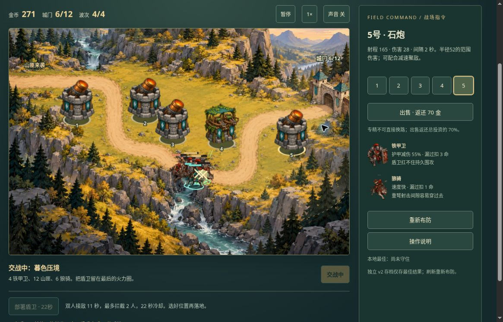

# 山口守望 v2：公开浏览器有限实玩

日期：2026-10-19。运行版本：[d7dbe3ef](https://github.com/yydshly/classic-games-atlas/commit/d7dbe3ef017e55b6d151bd6debbb64324cb4258f)。桌面 Chrome，1165×747视口，通过普通网页鼠标与按钮操作，无资源或存档改写。

[试玩 v2](../../versions/v2/games/pass/) · [保留的 v1 八图](../../games/pass/) · [冻结 v1](../../versions/v1/games/pass/) · [首页对比](../../#compare=pass)

## 已验证的有限闭环

- 缚索路线：230金/12城门起步，4号弩台70金后专精110金。随后按预算补3、2、1、5号四座石炮；第二波两铁甲漏过后余6城门，末波桥前正常部署双盾。四波自然胜利：城门6/12、击退63、金币409、页面用时217秒。217秒包含观察和准备等待，不是纯战斗耗时或难度基准。
- 重弩路线：同样4号弩台立即专精、随后补3号石炮。首波使用2×，第二波回1×；快骑越过火力，城门8→0，第二波自然失败。未进入第三或第四波。两局速度操作和盾卫时机不同，不是严格平衡实验，不能说两分支均由真人通关。
- 暂停/继续、暂停时盾卫禁用、部署取消仍就绪、不消耗盾卫、双盾实际接敌和撤退已观察。重新布防恢复230金/12城门/0波/空塔位。
- 正常刷新回准备态，最佳6/12·217秒保留。v2只保存最佳，不恢复未完战斗；旧v1记录独立保留，本轮没有重玩原八图。

## 真实运行图

[打开原尺寸截图](../../assets/screenshots/v2/pass-v2-final-wave-running.jpg)。1165×747桌面视口，未裁切或改绘。画面金币271、城门6/12、波次4/4，属于末波桥头交战，不是胜利帧。页面已正常向下滚动，HUD、完整战场和部署按钮可见，页头在外；不能据此称初始首屏全部同屏或手机通过。密集敌我重叠如实保留。

## 已知问题与未验范围

- 初始页面的HUD、战场和下方指挥控件并不全同屏，需要滚动。底图及塔、铁甲、快骑、盾卫均正常显示；桥头重叠明显，单兵受击与阻挡归属不如血条/脚圈清楚。
- 取消部署后仍留“点击高亮山路”提示；胜利按钮仍写“开始第4波”，失败按钮仍写“交战中”但已禁用。主状态全清/失守正确。本轮记录这些小文案问题，没有扩展修复。
- 重弩完整四波、更多策略/长期平衡、v1八图重玩、声音实际听感、400窄屏、原生触屏、完整连续动画、音画同步及审美未验。有限成功不等于完整品质验收。

## 范围、参考与证据区分

原v1已有建塔、经济、升级及速度控制；新v2独立加入重弩/缚索二选一和可部署盾卫，仅一个短图四波。九张AI辅助原创WebP用于真实场景和实体；运动为精灵位移、轻摆及攻击效果，不是完整逐帧动画。

[发布时NOTES](../../versions/v2/games/pass/NOTES.md)保留8组规则、5组DOM替身与离屏图说明。该文件的“浏览器待验证”为发布时状态，有限线上结果以本记录为准。模拟双分支通关及同场首名铁甲击杀差异，不能替代本轮缚索胜/重弩败的实玩结果。

类型参考：[Ironhide官方Kingdom Rush介绍](https://www.kingdomrush.com/kingdom-rush)、[官方机制资料](https://www.kingdomrush.com/kingdom-rush-presskit)。借鉴塔专精取舍与援军接敌，原作的多种能力和战役没有完整覆盖。原作名称及素材权利属于原权利人；本项目未复制原作图像，也不宣称授权、完整复刻或达到原作质量。
