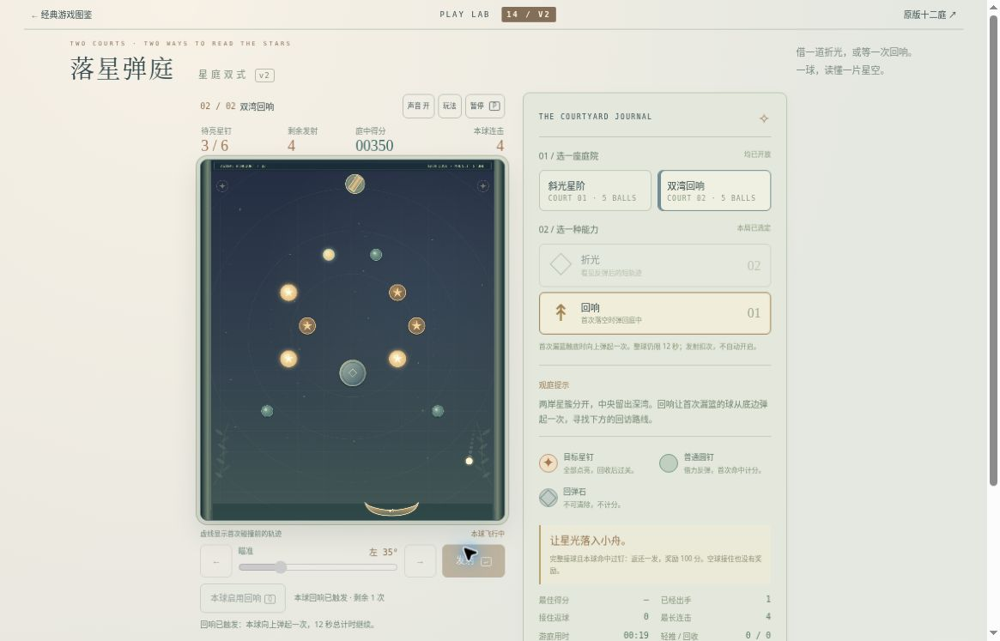

# 落星弹庭 v2：公开浏览器有限实玩

2026-10-19，云端桌面Chrome，正常按钮、角度滑杆及键盘。运行版本：[1a8344b6](https://github.com/yydshly/classic-games-atlas/commit/1a8344b63c8751ca3f924a980a963e91d2e5af39)。使用给定参考角度，非独立盲解；过程穿插暂停和整球回滚验证，不是连续无刷新通关。结算出手数是恢复后保留的本局统计，不是全部实际发射操作次数。

[试玩v2](../../versions/v2/games/pinfall/) · [保留v1十二庭](../../games/pinfall/) · [冻结v1](../../versions/v1/games/pinfall/) · [首页对比](../../#compare=pinfall)

## 两庭结果

1. 斜光星阶，折光：自然胜利1555分、出手5次、接住返球2次、剩余2发、最长连击3。实际保留的角度序列为−30、−30、−10、2、12度；第二次−30是在第一球回收后正常按空格发出。首球清两目标并返发到335分，第二球355分，第三球启用第二次折光并经回滚重发后455分/待亮2，第四球返发到655分/待亮1，第五球胜利。页面01:26包含瞄准与观察，不是纯飞行时间。
2. 双湾回响，回响：自然胜利1485分、出手3次、接住0次、剩余2发、最长连击4。角度−35、35、−25度，前两球各显式启用一次。首球有“回响已触发”状态，活动帧350分/3待亮/连击4，白球在右下。第二球经已命中后的回滚验证再发，结算585分/待亮1，第三球成功。页面00:53也包含瞄准观察。

两庭在预算内自然完成，不为用尽5发继续发射；未遇自然球尽失败。末发耗尽时返球优先未实玩。

## 能力与中断

折光启用后可见青色首碰后短段，启用仍保留2次、发射才扣1，取消启用不扣。实际星钉命中反弹可见，但没有连续记录首反前后方向，不能声称精确轨迹一致已实测。

飞行时发射、角度、能力按钮禁用，局中能力选择锁定。首庭第三球飞行后追加空格、Q再暂停，出手仍3/余3发/折光0，没有多发或换能力；暂停冻结。该球刷新恢复到出手前4发/355分/待亮3/出手2/折光1，先暂停并保留启用选择，之前已耗的1次不返还。

第二庭做了已命中后的整球回滚：
- 出手前350分、待亮3/6、4发、出手1、回响余1。
- 第二球35度启用，飞行取得实际命中后，暂停在555分、待亮1/6、3发、出手2、回响余0。
- 刷新先暂停，回350分、待亮3/6、4发、出手1、回响余1、连击0；此前首球消费仍保留。再次发射仅再扣本球1次。

这证明当前整球回退，不是保存半空位置和半球收益。首庭第三球与第二庭第二球是两次不同检查。

第二庭首/次球均显示已触发，首球图可见球在场内和已亮目标。没有连续抓到底边接触及上返新增命中瞬间，不能把350分全归上返阶段。

普通暂停遮罩仍可能残留“上一球已接续/飞行整球已回退”措辞，即使刚暂停、尚未刷新；实际余发与分数没有当场回退。这是已知提示残留。

重访第二庭回准备：6目标、5发、0分/0出手、回响2，最好1485保留；再次刷新准备态仍保留。旧版入口实际进入01/12准备态6目标/5发/0分，没有重玩旧12关。

## 真实运行图与布局

[打开原尺寸截图](../../assets/screenshots/v2/pinfall-v2-echo-flight.jpg)。1165×747真实网页原图，未裁切或改绘、无遮罩。第二庭首球页面00:19，350分、待亮3/6、余4发、连击4、回响余1且已触发；右下白球、尾迹和亮钉可见。它不是底边接触瞬间或胜利图，时间含瞄准观察，分数不单归上返。

正常滚动后，约358×425的完整球场、四项HUD、暂停、角度、发射与启用能力同屏；侧栏底部记录、重试、完整说明仍需下滚，不称整页全部同屏。上述尺寸来自一次重试后的布局读数，截图所在滚动位置不同，不混用精确坐标。

两庭色调和目标分布有差异，程序Canvas星钉、普通钉、回弹石、小舟、球尾均可见，没有资源空白硬故障。主场偏小，游戏运行没有新增位图；声音开关开启不代表实际听验，技术可玩不代替审美品质验收。

## 参考与未验

原v1已有球尾、命中发光、涟漪、返球及12庭；本轮只补两庭有限能力选择。[EA的Peggle介绍](https://www.ea.com/games/peggle/peggle)说明瞄准反弹与多种能力；[2013年EA/PopCap Peggle 2发布说明](https://s204.q4cdn.com/701424631/files/doc_news/2013/12/1/812500.pdf)明确Super Guide显示第一次反弹路径。折光参考这一可读路线思路，回响是本作自定单次底反。历史目录以初代为主，不能把新增参考说成完整Peggle 2复刻。

[运行范围与规则说明](../../versions/v2/games/pinfall/NOTES.md)和9条完整引擎路线、17项物理、8项存档/控制器、4类DOM场景及离屏画面分开于本页实玩；模型通关不增加人工成绩。

未验：球尽失败、末发返球优先、全部12秒回收/两次轻推/空接边界、首反精确连续一致性、连续鼠标悬停瞄准、声音听感、400窄屏/原生触屏、长期策略、审美和整体品质。仍为有限候选，未完成品质验收。
