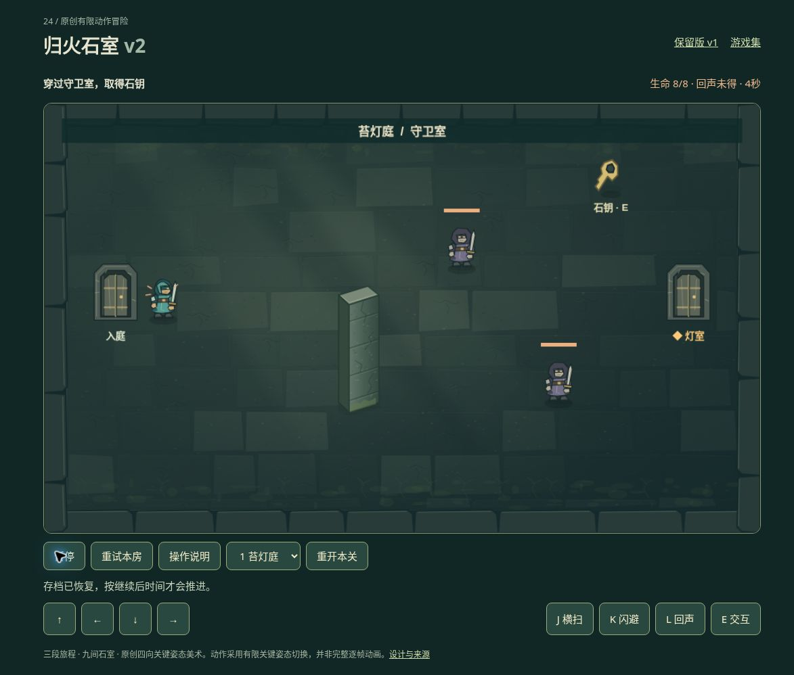

# 归火石室 v2：有限公开浏览器实玩

日期：2026-10-19。运行提交：[71edba80](https://github.com/yydshly/classic-games-atlas/commit/71edba80a8a9a48e1f17167b348d0d8495934188)。[打开独立 v2](../../versions/v2/games/ruins/) · [保留 v1](../../games/ruins/) · [范围与模型证据](./VERIFICATION.md)

使用桌面 Chrome 的正常页面按钮和真实 WASD/J/K/L/E 按键，未改存档、位置、生命、机关或胜负。模型和离屏渲染不作为此处实玩证据。过程多次暂停观察，以下秒数为游戏内结算时间，不表示连续无暂停或普通玩家时长。

## 已实际完成

- 第一关：绕守卫室石墙取钥匙、进入灯室点灯，再沿原路回入庭归途门按 E。58 秒，生命 6/8；有受伤和绕墙修正，没有重试刷胜。
- 第二关：取得能力前按 L，目标未改变；侧室取回声灯后刷新，恢复 6 秒、8/8 生命、已得回声并暂停。继续返回门厅，在栅栏左侧面向机关按 L，机关显示“已开启”，右门解锁。再走至归途门按 E，26 秒、8/8 完成。未单独验证未解锁门拒绝，也未独立实玩石墙挡波。
- 第三关：点亮两侧灯后唤醒守卫。观察金色前摇区、红色攻击区和护甲抵挡提示；恢复期按 L 显示破甲，再靠近分次按 J，守卫血条减少直至消失。此时仍未结算，向上走到归途门按 E 后才完成三关。52 秒、2/8；本轮未重试第三关。移动按住持续，动作需分次按键，不是长按自动连续出招。
- 额外首关自然失败：在守卫附近释放全部游戏按键，生命从 7 秒时 8/8，降到 18 秒时 2/8，再到 22 秒时 0/8，自然出现失败。这确认当前房间敌人在没有玩家输入时仍会行动。
- “重试本房”恢复守卫室入口、8/8 生命、4 秒并暂停；刷新仍保留该状态。第二关已取得回声的快照和首关入口检查点有实际恢复证据。多次暂停观察时，时间与血量保持不变。

## 实际整页图与布局问题

[查看未裁切的完整页面原图，1173×998](../../assets/screenshots/v2/ruins-v2-public-fullpage.jpg)

这是真实浏览器完整页面截图，内容包括首关守卫室、人物、两名敌人、门、钥匙、石墙、HUD 与操作按钮；拍摄时显示 8/8 生命、4 秒，按钮为“暂停”。图片未裁切，也不是离屏渲染图。

完整页面高度 998 像素超过本轮 751 像素高的截图视口。画布约 1060×637，主要控制行按钮高约 42 像素，动作按钮另占一行。HUD、整个画布和底部控件不能同时完整显示，必须正常滚动，宽屏同屏条件未通过。整页图不能用作同屏证明。未观察到素材空白，主要标签可读；这不等于全面可用性或美术验收。

已知轻微文案问题：继续运行后，“存档已恢复，按继续后时间才会推进”仍残留。画面无遮罩、按钮已为暂停；本轮只记录，未改运行代码。

## 尚未验证与品质边界

- 仅三条有限通关路线和一次首关自然死亡/房间重试，不能证明所有操作、所有参数或完整平衡。
- 400/390 窄屏、原生触屏与多指、其他屏幕尺寸、拒绝存储、终局刷新、取消重开、失焦粘键均未验。
- 石墙挡波和预警锁向没有独立严格实玩对照；既有模型证据仍与浏览器证据分列。
- 环境、角色和物件全部为原创程序绘制 SVG；是简化 2D 和有限方向关键姿态，不是图像生成模型素材或完整逐帧动画。当前视觉质感仍未达要求，操作手感、探索乐趣、审美与整体品质未完成验收。
- v1 原有横扫、闪步、钥匙灯和预警继续保留；本轮实时推进和回声回访不能被描述成完整塞尔达复刻。
