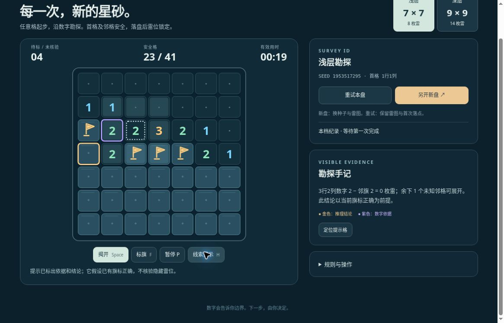

# 星砂勘探 v2：公开浏览器有限实玩记录

实玩时间：2026-10-19 23:56 至 2026-10-20 00:02 UTC。桌面 Chrome，普通左键揭开／点数字展开、右键标旗与页面线索提示。依据公开数字和页面解释手动解盘，两档各一次成功；不是盲解或无提示难度验收。状态仍为有限候选，未完成品质验收。

- [运行版本 669ec93](https://github.com/yydshly/classic-games-atlas/commit/669ec933cf0a9c8823cb1902d99f8617c82e4507)
- [该版本部署记录](https://github.com/yydshly/classic-games-atlas/actions/runs/39344394081)
- [试玩新局星图](../../versions/v2/games/sand/) · [规则与参考来源](../../versions/v2/games/sand/NOTES.md)
- [原版二十关](../../games/sand/) · [冻结 v1](../../versions/v1/games/sand/) · [首页对比](../../#compare=sand)

## 两档实际完成

| 档位 | 首格与 seed | 结果 |
| --- | --- | --- |
| 浅层 7×7／8 雷 | 1行1列；1953517295 | 初开22/41，最终41/41；01:20、10次提示 |
| 深层 9×9／14 雷 | 5行5列；1409780751 | 初开14/67，中心3×3公开安全；最终67/67；02:21、20次提示 |

浅层终局仍待标1，揭完安全格即可完成，不要求所有雷都插旗。时间为页面有效计时，包含读数字和查看提示，不当作纯点击速度或无辅助水平。角首格与中心首格是本轮实际覆盖，不能推广到所有首格。

## 保存、同盘与新盘

- 浅层22/41、4旗、00:12暂停刷新，同seed、首格、已开数字和四旗保留并先暂停；继续后才计时，随后完成。
- 深层成功后“重试本盘”，seed1409780751与首格5,5保留，初开14格的数字形状相同；旗与时间归零，最好20提示／02:21保留。
- 补一次主动失败检查：用普通左键点此前由公开数字推知的3行4列雷格，00:05、14/67真实触雷，红色菱晶显示触雷点。这是主动检查失败处理，不能写成自然解题误判。
- 再次同盘重试后，“另开新盘”变为seed1307954740、0/67、00:00、等待首格，最好保留。没有展开新盘或再解第三盘。
- 切回浅层，已完成41/41及10提示／01:20仍在；深层新盘与20提示／02:21独立保留。最后刷新停在深层seed1307954740等待首格。
- 同盘一致性依据公开seed、首格、初盘数字和已知雷格实际触雷，没有逐项比较隐藏雷位；新seed变化也不等于完整雷图差异已验证。

## 真实运行图

[查看未裁切原尺寸运行截图](../../assets/screenshots/v2/sand-v2-clue-flags-running.jpg)

原图1165×747。浅层23/41、4枚旗、待标04、00:19；3行2列紫色依据、4行1列金色结论。右侧解释“数字2减邻旗2，余下1未知可展开”，以当前旗标正确为前提。无遮罩、没有显示隐藏雷，非终局或无提示盲解证据。

## 页面、机制与未验边界

- 当前滚动位置，约400×400完整棋盘、HUD、揭开／标旗／暂停／提示按钮，以及右侧重试／新盘／解释可见。顶部图鉴导航和部分标题滚出，不能称整页首屏同屏。终局块在棋盘下方，不遮挡棋盘，页面会滚动。
- 零区正常连开，数字、旗、依据与结论可读。画面为原创程序SVG简化网格与图标，未新增运行位图或生成图素材，没有审美通过结论。
- 原v1已有数字、旗、零区、快捷展开、解释式提示及日志恢复；本轮主要增加两档seed新盘、任意首格邻域安全、有界筛选与分档保存。原二十关入口实际打开01准备，4×4一雷、0/15，未重玩。
- 两盘生成未观察到明显卡顿或超限，但没有测量耗时，也未实测128次耗尽。13000局抽样与上限检查属于本地模型证据，不能证明所有种子可生成、所有走法无猜或所有人觉得容易。
- 错误旗标后的提示是否不暗中修正、错误旗快捷展开触雷、全部首格／seed、生成时延分布、全键盘流程未验。
- 声音反馈、400 CSS窄屏、原生触屏、总体美术和手感品质未验。两次有提示成功与一次主动点雷不代表自然失败频率、无辅助难度或全面品质通过。

## 原作参考边界

[Microsoft Minesweeper 官方作品入口](https://www.microsoftcasualgames.com/minesweeper)是数字排雷类型的参考链接。历史目录以经典Windows扫雷为代表；本作不据该页面断言某个Windows版本的首开生成算法。首邻域安全、seed方案与最多128次可见规则筛选是本版实现选择，界面、菱晶和旗标为原创程序绘制。
