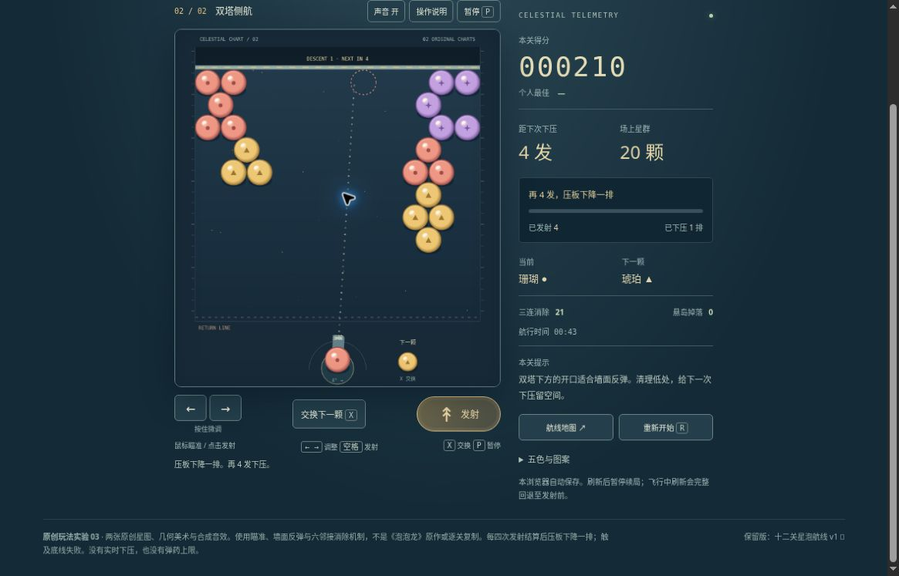

# 星泡航线 v2：有限公开实玩记录

2026-10-20 UTC 00:23–00:33，公开桌面 Chrome，普通瞄准、发射、换弹、暂停、选关、刷新与重试。使用公开参考路线，第一关后半按可见颜色调整，非盲解。此记录只覆盖下列操作，未完成品质验收。

- [当前 v2](../../versions/v2/games/starline/)
- [保留的 v1 十二图](../../games/starline/) · [冻结 v1](../../versions/v1/games/starline/)
- [规则、原创范围与官方来源](../../versions/v2/games/starline/NOTES.md)
- [此次运行代码](https://github.com/yydshly/classic-games-atlas/commit/ef6b3d3b663a7374ae8f651505fea70378270674)
- [部署记录](https://github.com/yydshly/classic-games-atlas/actions/runs/39346970367)

## 结果

| 对局 | 实际结果 | 发射 / 下压 | 消除 / 掉落 | 页面时间 |
| --- | --- | --- | --- | --- |
| 第一关 | 清场，1260 分，1 星 | 19 发 / 4 排 | 51 / 2 | 03:47 |
| 第二关 | 清场，1460 分，3 星 | 6 发 / 1 排 | 33 / 10 | 00:52 |
| 第二关额外低效测试 | 触底失败，0 分，场上 45 颗 | 8 发 / 2 排 | 0 / 0 | 00:54 |

时间含瞄准、阅读和观察，不是纯操作速度。第一关没有复现模型 7 发解；实际 19 发成功与第二关参考路线 6 发成功分开记录。额外失败为刻意持续正上方、不换弹的低效操作，正常按钮产生触底结果，不称自然策略误判。

## 规则与反馈

- 第一关第 4 发结算由 0 排变 1 排，26 颗、120 分，距下次下压重置 4 发；第 8、12、16 发后继续下压。第二关第 4 发后为 20 颗、210 分、1 排，实际压板与星群共同下降。
- 每完整结算 4 发才下压，瞄准不限时。换弹不增加发射和下压计数；飞行中发射、换弹不可用。触底失败不是弹药耗尽。
- 公开左向墙反路线发射后消除增加，但未保留连续墙面接触与反向瞬间，精确首反角度未验。
- 第一关掉落 2；第二关第 5 发后掉落 3、第 6 发累计 10，HUD 与前后群组消失对应；完整掉落动画未逐帧验证。虚线和落点圈可见，下压前后逐格预测一致性未实测。

## 暂停、刷新与旧版

1. 第一关首发结算 60 分、29 颗、1 发、0 排。换弹后第二发飞行中暂停刷新，恢复到出手前：60 分、29 颗、1 发、0 排、距压 3 发，珊瑚 / 薄荷，先暂停。保留出手前换弹，不是回到换弹前。
2. 第 4 发结算 120 分、26 颗、4 发、1 排、距压 4 发，暂停刷新保持该状态，没有重复下压。
3. 失败后重试，再暂停刷新，第二关 0 分、0 发、0 排、37 颗、00:00、距压 4 发，先暂停，最好 1460 保留。
4. 两张图可直接选择。旧十二图入口实际打开第一关准备态：01/12、6 颗、10 次发射、00:00；未启动旧版对局。

## 真实画面

[打开原尺寸截图](../../assets/screenshots/v2/starline-v2-second-descended-running.jpg)

1165×747 原始桌面截图，未裁切。第二关 00:43、210 分、20 颗，已 4 发 / 下压 1 排、距压 4 发，消除 21 / 掉落 0；当前珊瑚、下一颗琥珀。无遮罩，结算后待瞄准，并非飞行、墙反接触或终局帧。

滚动后约 426×469 场地、HUD、发射 / 换弹 / 暂停及右侧统计可见，顶部导航和标题已滚出；不能据此称整页初始视口全部同屏。程序 Canvas 几何泡泡和压板可辨，本轮未发现硬操作阻塞，仅为有限操作证据。

## 尚未验证

精确墙反接触帧、压前压后逐格预览一致性、完整掉落动画、所有角度和随机种子边界、声音听感、400 CSS 窄屏、原生触屏、审美与完整品质。模型大量轨迹和规则测试不等于真人体验或难度验收。

[回到首页对比](../../#compare=starline)
