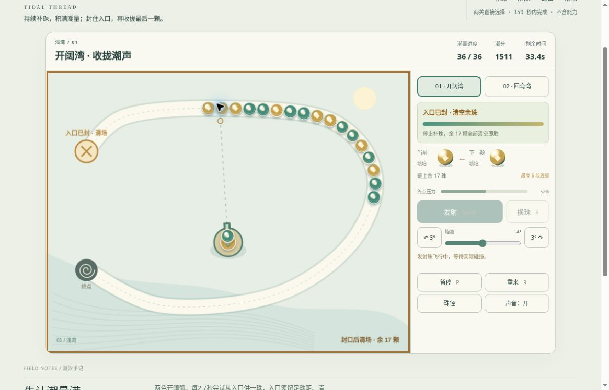

# 潮汐珠径 v2：公开桌面浏览器有限实玩

日期：2026-10-20，UTC 07:14–07:22。运行提交 [d70831b1](https://github.com/yydshly/classic-games-atlas/commit/d70831b182575816c43663d0ad0a1389996bc702)，[Pages 部署记录](https://github.com/yydshly/classic-games-atlas/actions/runs/39384874130)。

[独立 v2](../../versions/v2/games/tide/) · [原版十二关](../../games/tide/) · [冻结 v1](../../versions/v1/games/tide/) · [范围与来源](../../versions/v2/games/tide/NOTES.md) · [首页对比](../../#compare=tide)

## 实际结果：两图封口，均未清场

桌面 Chrome，两图各一局普通鼠标瞄准点击，第二图另用 X 换珠，P 暂停。只读页面教程和可见珠链，未读模型解。两局均自然到 150 活动秒超时失败，没有追加刷胜。

- 开阔湾：41/36 潮量、1675 分、余 11 珠、最高 5 连、压力 71%。此前达到 36/36 后入口变叉，显示已封口，但未清残局。
- 回弯湾：42/42、1221 分、余 11 珠、最高 4 连、压力 61%。同样封口后仍有珠，超时失败。
- 清场胜利尚未验证，收尾难度需评估，不能算玩法验收。模型 80/107 秒胜利不替代本次实玩。

150 秒是活动倒计时，观察思考也消耗时间，首局还曾暂停。本轮远程操作间隔较长，部分瞄准后珠组已移动、出现空发；不能据此断言产品命中缺陷，也不能证明普通本地操作手感或难度通过。

## 实际观察与恢复

首图开局 10 珠，随后供入到 13 并继续增长；可见消除使潮量到 12/36、30/36，再到 36/36 封口。封口后未恢复供入，余珠仍前进并接收发射珠。最后 41/36 是已消补给珠数超过目标，不据此判为错误。

第二图不同回弯路径、三色珠可见，潮量逐步到 42/42 后封口。X 换珠后实际射出珊瑚和琥珀。实际飞行中发射及换珠按钮禁用；衔接中显示等待提示。首发消组三颗后潮量为 2，与仅计两原珠的规则相符，但未逐颗追踪全部身份。没有实际看到零珠暂清后继续供入。

首图已发射后暂停：12/36、494 分、剩 121.4 秒、余 8 珠、最高 3 连、压力 17%、角度 -34°，青玉/琥珀。正常刷新后可见读数一致且先暂停，继续后青玉弹仍飞行并接入。未逐像素或对全部供珠相位比对。

第二失败后重试回准备态：0/42、0 分、150 秒、12 珠、压力 17%、0°、琥珀/青玉。P 不启动准备态；刷新仍相同。底部通用“暂停在原来的珠链”恢复提示没有细分准备态，已记录为文案问题。

原版十二关链接实际打开，首关 0/12、0 分、0.0 秒、12 珠准备页可见，未重新实玩原版；旧能力仍在原入口。

## 真实运行图

[查看未经裁切的原尺寸截图](../../assets/screenshots/v2/tide-v2-supply-running.jpg)

1165×747，首图 36/36、1511 分、剩 33.4 秒、余 17 珠、最高 5 连、压力 52%、-4°。入口已封，青玉发射珠刚离开炮座，当前/下一颗均琥珀，按钮显示暂停 P。无遮罩活动帧，非终局或撞击瞬间，也不是仍持续供珠；文件名 supply 不代表画面仍在供入。

## 布局与未验

颜色和形状标记、两条曲线、封口标识、炮座与弹仓可辨。滚动后游戏标题/HUD、完整珠径和主要按钮可见，网站导航、大标题和底部手记未全显示，不是整页始终同屏。未遇到必须修改运行代码的硬阻塞。

未验：清场胜利、零珠暂清续供、触线失败与同时清场优先、全边界相位恢复、长按限制、原生触屏、手机布局、声音听感和审美品质。声音开关为开不代表已经听验。

## 2026-10-20 稳定原生滑杆路径首胜补充

[独立普通UI强辅助证据](../tide-first-win-qa/)新增首图71.45活动秒/1659分/53发/36潮量/余珠0，一次封口与结算、刷新最好保留。用正常暂停和原生角度滑杆/按钮，不用画布点击坐标；53次角度、焦点与实际日志一致，实际54条日志另做离线审计。未改游戏或难度，原150秒两次超时和远程鼠标限制保持，不把模型或强辅助成绩当人工手感验收。
