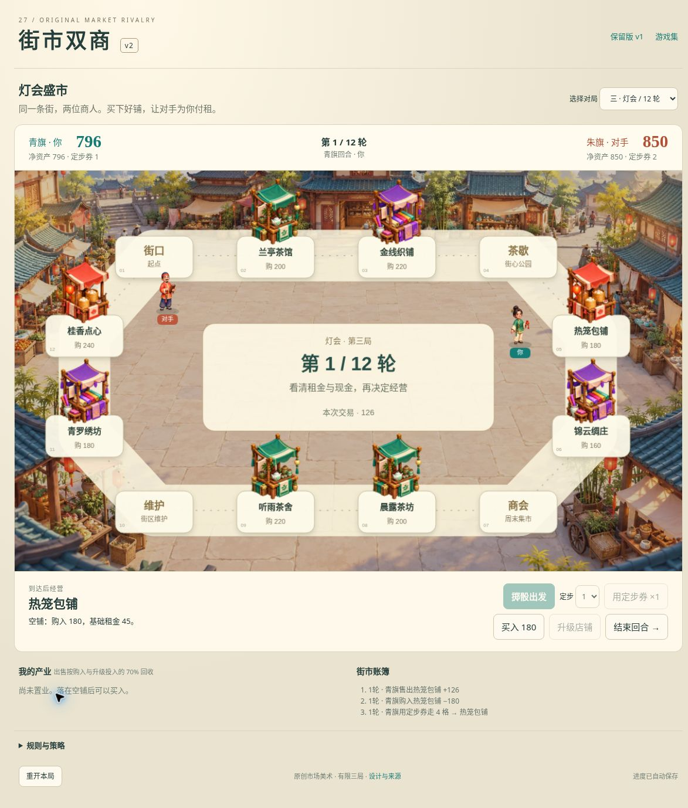
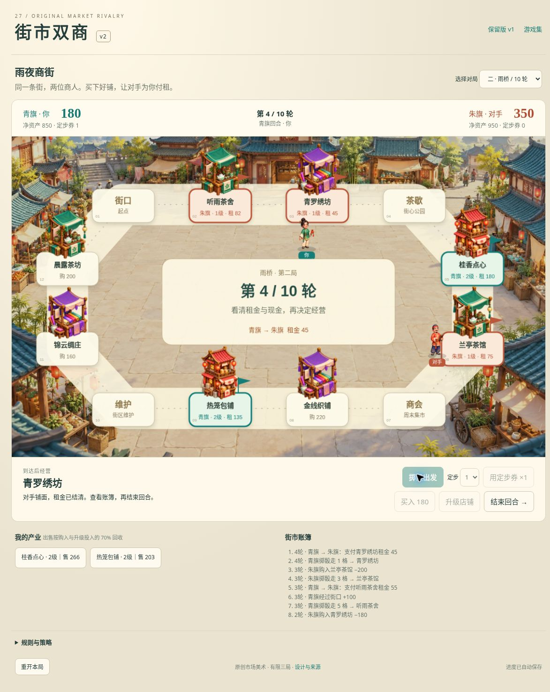

# 街市双商 v2：分版本的有限公开实玩

日期：2026-10-19。[当前 v2](../../versions/v2/games/venture/) · [保留 v1](../../games/venture/) · [设计与来源](../../versions/v2/games/venture/SOURCES.md)

桌面 Chrome 中使用正常按钮和选择框，没有修改种子、现金、产权、位置或胜负。三场各玩一次，不重打追胜。模型、DOM 模拟与离屏图不计入以下真实实玩。

## A. 修前版本：三场完整对局

运行提交：[8edbd1a7](https://github.com/yydshly/classic-games-atlas/commit/8edbd1a74fa8868b535a31b84ea63710e33d0036)。以下三场结果全部属于此版本，不能写成取整修补后的整局回归。

- 晨市 8 轮：净资产青旗 1084 : 朱旗 1080，胜；现金 414 : 440。第 8 轮青旗结束后还须等朱旗行动才结算。首轮定步 1，180 买铺再花 110 升级，现金 850→560，净资产仍 850，等级 2、租 90、升级禁用。朱旗自然经过街口并支付 90 租给玩家。收租后刷新现金和账簿未重复。出售听雨茶舍先取消，不改变 600 现金/1110 净资产；确认回收 154 后为 754/1044、产权消失，随后对手自然买走并升级该空铺。
- 雨桥 10 轮：净资产 1555 : 680，胜；现金 385 : 40。实际向对手支付 55 和 45 租，付款后刷新保持现金、落点与单条记录；对手也实际向玩家付租。第 7 轮对手现金 50，需付 135 租，自动卖掉原价 180 的铺面回收 125，再付租余 40，没有破产。回收少 1 元是本次发现的浮点取整缺陷，因此这一终局数值仍保留为修前结果。玩家之后可正常买入已清算的空铺。
- 灯会 12 轮：净资产 950 : 1420，负；现金 190 : 530。自然败局保留，没有重打。结算刷新保留结果，经营和出售禁用；取消重开不改变终局，确认重开才回第 1 轮、双方 850、各券 2、空产权。

三局都是同一十二格环路和同一市场底图；店铺位置顺序确实变化，轮数为 8/10/12，集市收入为 70/50/100。实测雨夜标题下仍是日间市场背景，不能宣传三张不同地图或明显昼夜美术变化。观察到对手不同购买、升级和用券选择，但三局样本不证明策略强度、平衡或耐玩。

### 修前保存证据

首轮结束玩家回合后刷新，待执行的电脑回合只处理一次；掷骰落地后刷新保持同一落点，不能重掷。实际双向租金后刷新不重复收付；第三场终局可恢复。普通按钮等待不等于专门双击压力测试，未实测动画中切局/重开后旧回调隔离。

## B. 修补及修后定向回归

修补提交：[dc635ad8](https://github.com/yydshly/classic-games-atlas/commit/dc635ad8226202de0e890531195e4d6a85fd260d)。只将出售/清算回收的浮点乘 0.7 改为先乘 70 再除 100 取整，并为完整模块链加上 sale-rounding-r1 缓存标识；没有调节价格、租金、AI 或胜负平衡。

17 组规则和 DOM 模型回归通过，含独立期望 180→126、290→203、350→245，三棋盘×八铺×两级的 BigInt 计算对照，以及构造的清算 50+126−135=41。这些是技术测试，不是浏览器自然对局。

修后真实浏览器加载 sale-rounding-r1：在正常重开后的灯会第 1 轮，用定步 4 到热笼包铺，花 180 买入，现金 850→670；出售挂牌为 126。正常确认出售后，现金 670→796，净资产 796，产权清空、铺面恢复可购买。刷新后仍第 1 轮 796 : 850、玩家券 1、同一空铺，账簿只有一次 −180 和一次 +126，无重复入账或产权恢复。

本次仅复核购买、出售及刷新。没有重跑三场完整对局，没有额外实玩修后自动清算或租金流程；不能把 A 节三场成绩移到修后版本。

## 两张未裁切的真实整页图

### 当前修后：出售后刷新

[打开当前版原图，1173×1378](../../assets/screenshots/v2/venture-v2-sale-fixed-fullpage.jpg)

这是出售后刷新状态，显示 796 现金、空产业和单条 +126 账簿，不是三场通关画面。

### 历史修前：雨桥经营中

[打开修前原图，1173×1475](../../assets/screenshots/v2/venture-v2-rain-fullpage.jpg)

修前雨桥第 4 轮，现金 180 : 350，双方已有产权，刚支付 45 租。只作旧版经营证据，不能表示修后全局已复验。

## 布局与未验边界

两张图均为浏览器完整页面截图，未裁切；页面高度超过本轮 751 像素高视口。棋盘约 1138×683，经营按钮约 44 像素；现金 HUD、完整棋盘、底部经营按钮不能同屏，需要正常滚动。整页图不是同屏通过证明。素材和产权标签可见，不代表用户审美或完整品质通过。

自然破产未出现：修前雨桥只是清算后成功偿债。未验 400/390 窄屏、原生触屏、多指、键盘流程、双击防重压力、动画中切局/重开回调、拒绝存储、坏档恢复、无障碍、声音、长期平衡、策略强度、反超感及审美。三个原创位图真实接入，商人仍为静态关键姿态插值移动。模型 300 局与实际三场及修后定向回归分别记录，均不构成整体品质验收。

## 2026-10-20 存储边界定向修复

后续只修坏档保全与写入失败恢复的提示，规则、AI、素材和旧档格式不变。[分开的修前公开复现、修后本地普通 UI 与故障 fixture 证据](../venture-storage-qa/README.md)；[可读截图页](../venture-storage-qa/)。本段不追认上述旧版本未验边界，也不将本轮短流程写作三局完整通关。
