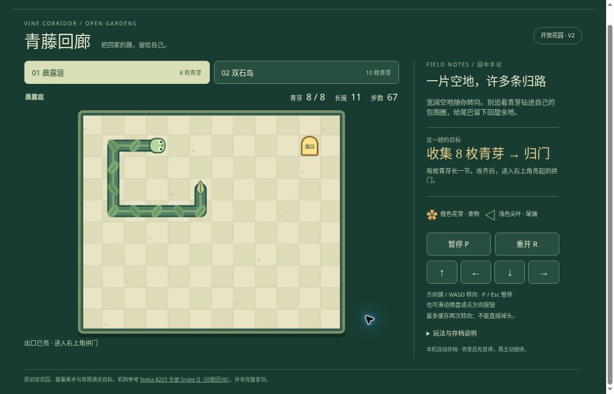

# 青藤回廊 v2：公开桌面浏览器有限实玩

日期：2026-10-20，UTC 06:48–06:55。运行提交 [619a87af](https://github.com/yydshly/classic-games-atlas/commit/619a87af703f2823687005a847af1d6e32214ff5)，[Pages 部署记录](https://github.com/yydshly/classic-games-atlas/actions/runs/39382271597)。

[独立 v2](../../versions/v2/games/vine/) · [原版十六关](../../games/vine/) · [冻结 v1](../../versions/v1/games/vine/) · [范围与手册参考](../../versions/v2/games/vine/NOTES.md) · [首页对比](../../#compare=vine)

## 实际操作与结果

桌面 Chrome，普通点击、方向键和 P 暂停，仅看页面教程与可见棋盘选路，未读取作者模型路线。两张开放图各玩一局，均多次暂停看盘；不是连续不暂停盲跑，也不是完整品质验收。

- 晨露庭：8/8 青芽、长度 11、74 步实际进入出口获胜。第 64 步收齐时仅点亮出口，仍需归门。
- 双石岛：10/10、长度 13、100 步获胜。实际经过两块 2×2 石岛外缘与岛间走道，第 91 步收齐后继续归门才结算。
- 食物在多处逐次出现，每次吃到后身体增长。未收齐时经过出口格不提前获胜。
- 没有自然失败，本轮未验证碰撞死亡、失败界面及失败后重试。纯规则/事件模拟的 74/102 步是另一类证据，不替代本轮实际 74/100。

## 暂停、恢复与重游

首图 1/8、长度 4、5 步暂停刷新后，蛇身、右侧食物和朝上方向一致，界面先暂停；继续后完成同一局。多次 P 暂停观察期间步数、身体和食物不变化。

第二图胜后“重游本图”直接开局，不停在准备态。即时观察 0/10、长度 3、0 步；紧接刷新前已前进 1 步，恢复后为 0/10、长度 3、1 步先暂停。不能将这一步写成刷新额外移动。最终留在该状态。

原版链接实际打开 01/16、0/3 青芽、长度 3、0 分准备页，没有重新玩原十六关。

## 真实运行图

[查看未经裁切的原尺寸截图](../../assets/screenshots/v2/vine-v2-exit-running.jpg)

1165×747，首图 8/8、长度 11、67 步；出口已亮，蛇头朝右，仍未进入门格，右侧显示“暂停 P”。这是无遮罩活动帧，不是终局、暂停遮罩或采食瞬间。两局多次暂停自行看盘；视觉尚未用户认可。

## 布局与未验

绿色格盘、浅色尖尾、眼睛蛇头、橙色食物、石岛与亮起出口实际可辨；没有遇到加载或操作硬阻塞。结算位于棋盘下方。

点击开始后页面有少量滚动，顶部导航滚出。运行截图中棋盘、青芽/长度/步数、暂停/重开及方向按钮完整可见；展开手记后需要正常滚动，不能称整页始终同屏。

本轮未验证自然失败与失败重试、自撞/尾格、反向拒绝、两转向缓冲极限、失焦冻结、所有食物生成状态、声音、原生触屏与手机布局、持续动画细节及整体审美品质。画面为原创程序 Canvas，未声称接近原作完整效果。
